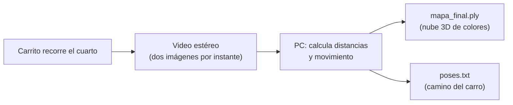

# ¿Qué es el proyecto?

> [!info] Nivel 1: Intuición · Anterior: [[00 Inicio]] · Siguiente: [[02 Arquitectura general]]

## La idea en una frase

Un **carrito con dos ojos** (una cámara estéreo) recorre un cuarto mientras alguien lo maneja con el teclado. La PC guarda todo lo que ve el carro y, al terminar, **reconstruye el cuarto en 3D**: un archivo con millones de puntos de colores que puedes girar en la pantalla. También dibuja **el camino que siguió el carro**.

## Una analogía

Imagina que entras a un cuarto con los ojos vendados, te dejan ver solo unos segundos por paso y tienes que dibujar un mapa. Para hacerlo, en cada paso te preguntas tres cosas:

1. **¿Qué tan lejos está lo que veo?** Tus dos ojos lo calculan solos: un objeto cercano se ve en lugares distintos con el ojo izquierdo y con el derecho. El proyecto hace lo mismo con dos lentes. Ver [[Camara estereo y disparidad]].
2. **¿Cuánto me moví desde el paso anterior?** Te fijas en cosas fáciles de reconocer, como la esquina de una mesa o un cuadro en la pared, y ves cómo cambiaron de lugar. El proyecto busca esos "puntos fáciles de reconocer" con **ORB**. Ver [[ORB 1 Intuicion]] y [[VO 2 En el proyecto]].
3. **¿Cómo junto todo?** Si sabes dónde estabas en cada paso y qué tan lejos estaba cada cosa, puedes poner cada punto en su lugar del mapa. Eso es la **nube de puntos**.

A ese problema de "hacer el mapa y saber dónde estoy al mismo tiempo" se le llama **SLAM** (*Simultaneous Localization And Mapping*).

## ¿Qué entra y qué sale?

## ¿Por qué "offline"?

La Raspberry Pi del carro es muy lenta para estos cálculos, y la parte que mide distancias (RAFT-Stereo, una red neuronal) necesita una **tarjeta gráfica NVIDIA**. Por eso el proyecto trabaja en dos momentos:

1. **Mientras manejas:** la PC solo **graba** las imágenes en disco.
2. **Cuando presionas X:** la PC procesa todo lo grabado y genera el mapa. Puede tardar varios minutos.

Es como grabar un video del cuarto y luego armar el mapa viendo la grabación con calma.

## Palabras que vas a ver mucho

| Palabra | En pocas palabras | Nota |
|---|---|---|
| Estéreo | Dos cámaras separadas unos centímetros | [[Camara estereo y disparidad]] |
| Disparidad | Cuánto se "mueve" un punto entre la imagen izquierda y la derecha | [[Camara estereo y disparidad]] |
| ORB | Algoritmo que encuentra esquinas y les saca una huella | [[ORB 1 Intuicion]] |
| Pose | Dónde está el carro y hacia dónde apunta | [[Pose y matrices 4x4]] |
| Odometría visual | Calcular cuánto te moviste usando solo imágenes | [[VO 1 Intuicion]] |
| Nube de puntos | Muchos puntos 3D con color que forman el mapa | [[Nube 1 Intuicion]] |
