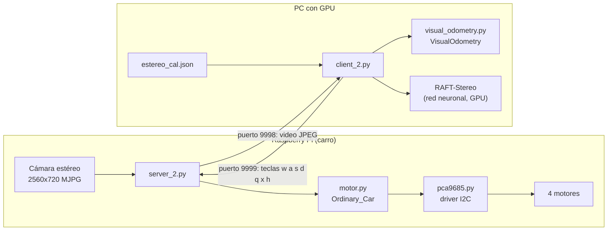
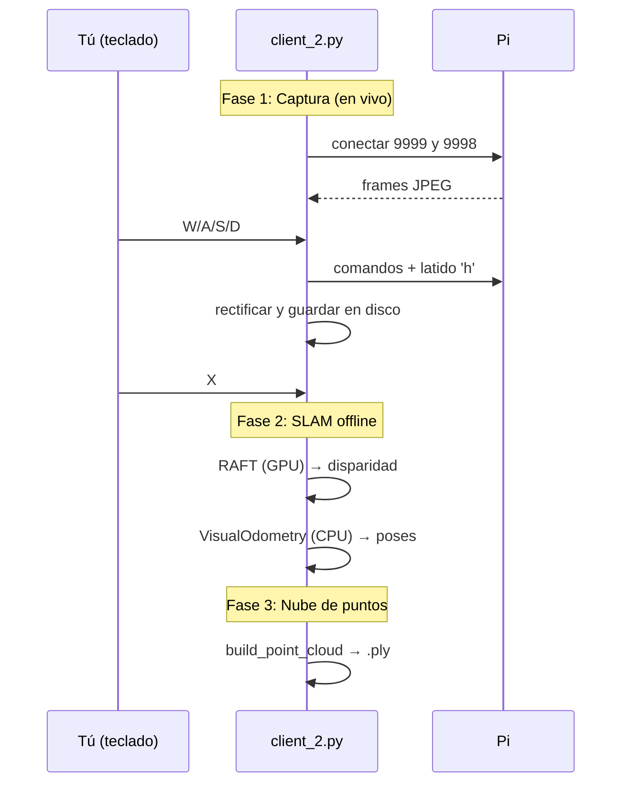
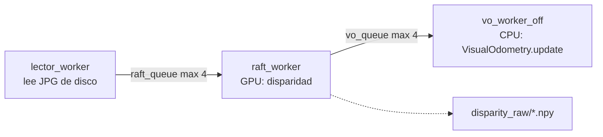

# Arquitectura general

> [!info] Nivel 2: Piezas y conexiones · Anterior: [[01 Que es el proyecto]] · Siguiente: [[03 Flujo de datos]]

## Las dos computadoras

El sistema se reparte entre dos máquinas, y cada una hace lo que mejor sabe hacer:

| | **Raspberry Pi** (en el carro) | **PC** (con GPU NVIDIA) |
|---|---|---|
| Rol en la red | **Servidor** (espera conexiones) | **Cliente** (se conecta a la Pi) |
| Archivo principal | `server_2.py` | `client_2.py` |
| Qué hace | Mueve los motores y manda video | Graba, calcula distancias, ubica al carro y arma el mapa |
| Por qué ahí | Está físicamente en el carro | Tiene la GPU que necesita RAFT |

## Cómo se hablan: dos sockets TCP

Hay **dos conexiones separadas** para que el video, que es pesado, no retrase los comandos:

| Puerto | Dirección | Qué viaja | Formato |
|---|---|---|---|
| **9999** | PC → Pi | Comandos | 1 byte por tecla: `w a s d` mover, `q` frenar, `x` salir, `h` latido |
| **9998** | Pi → PC | Video | `[4 bytes: tamaño][JPEG]` repetido |

> [!tip] ¿Por qué mandar el tamaño antes de cada JPEG?
> TCP es un **flujo de bytes**, no de mensajes. Si la Pi manda dos JPEG seguidos, la PC puede recibirlos pegados o partidos en cualquier punto. Por eso cada imagen va precedida por su tamaño en 4 bytes (`struct.pack('<L', ...)`, entero sin signo *little-endian*). La PC lee primero esos 4 bytes y luego exactamente esa cantidad (`recv_exact`). A esto se le llama ***framing***.

## Seguridad del carro

Estas dos protecciones están en `server_2.py` (detalle en [[Control del carrito]]):

- **Mantener presionado:** el carro se mueve solo mientras sigan llegando repeticiones de la tecla. Si pasan `HOLD_S = 0.6 s` sin recibirla, frena.
- **Watchdog:** la PC manda un latido `'h'` cada `HEARTBEAT_S = 0.25 s`. Si la Pi pasa `WATCHDOG_S = 1.0 s` sin recibir nada (la PC se congeló o se cayó el wifi), frena.

## Las tres fases del cliente

### Fase 1: Captura (4 hilos al mismo tiempo)

| Hilo | Función | Qué hace |
|---|---|---|
| `Video` | `video_loop` | Recibe JPEG, lo parte en izquierda/derecha, rectifica y lo mete a `save_queue` |
| `Save-IO` | `save_worker` | Saca de la cola y escribe en disco |
| `Commands` | `handle_commands` | Lee el teclado y manda teclas + latido |
| principal | `main` | Muestra las dos ventanas de vista previa |

> [!tip] Patrón productor-consumidor
> `video_loop` **produce** frames y `save_worker` los **consume**. La cola `save_queue` (máximo 30) los separa: si el disco se atrasa un momento, el video no se detiene. Si la cola se llena, aparece el aviso *"Guardado atrasado"*.

### Fase 2: SLAM offline (un *pipeline* de 3 etapas)

Mientras la GPU calcula la disparidad del frame *n+1*, la CPU ya está ubicando el frame *n*. Es el patrón ***pipes and filters***: cada etapa hace una sola cosa y le pasa el resultado a la siguiente.

### Fase 3: Nube de puntos

`build_point_cloud` toma cada disparidad y cada pose, convierte los píxeles en puntos 3D, los coloca en el mundo, filtra el ruido y guarda los `.ply`. El detalle está en [[03 Flujo de datos]] y en [[Nube de puntos]].

## Herramientas fuera del flujo principal

| Archivo | Cuándo se usa |
|---|---|
| `camera_calibration_dualCamera.py` | **Una vez, antes de todo.** Genera `estereo_cal.json`. Ver [[Calibracion y rectificacion]] y [[Calibracion estereo a fondo]] |
| `reprocesar.py` | Para repetir las fases 2 y 3 **sin el carro y sin RAFT**, con las `.npy` ya guardadas. Ideal para experimentar con parámetros |
| `ver_nube.py` | Abre los `.ply` con Open3D |
| `test_camera.py` | Prueba rápida de que la cámara abre |
