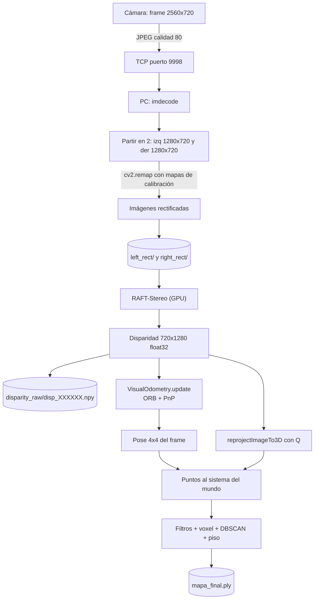

# Flujo de datos: de una foto a la nube 3D

> [!info] Nivel 2 → 3 · Anterior: [[02 Arquitectura general]] · Siguiente: [[04 Mapa del codigo]]

Vamos a seguir **un solo instante** del recorrido, desde que la cámara lo captura hasta que sus píxeles terminan en `mapa_final.ply`.

## El viaje en un diagrama



## Paso a paso, con forma y tipo de los datos

| # | Paso | Dato resultante | Forma / tipo | Dónde ocurre |
|---|---|---|---|---|
| 1 | La Pi captura | Frame estéreo lado a lado | 720×2560×3, `uint8` (BGR) | `stream_video` |
| 2 | Comprime | JPEG | bytes (~unos cientos de KB) | `cv2.imencode` |
| 3 | La PC recibe | Frame decodificado | 720×2560×3 | `read_one_frame` |
| 4 | Parte a la mitad | `raw_izq`, `raw_der` | 720×1280×3 cada uno | `video_loop` |
| 5 | Rectifica | `rect_izq`, `rect_der` | 720×1280×3 | `cv2.remap` |
| 6 | RAFT ([[RAFT 2 En el proyecto]]) | Disparidad | 720×1280, `float32`, en **píxeles** | `run_raft` |
| 7 | VO | Pose del frame | 4×4 `float64`, en **mm** | `VisualOdometry.update` |
| 8 | Reproyección | Mapa 3D | 720×1280×3 (X, Y, Z en mm) | `cv2.reprojectImageTo3D` |
| 9 | Al mundo | Puntos filtrados | N×3 | `build_point_cloud` |

> [!note] ¿Por qué rectificar? (paso 5)
> Después de rectificar, **un punto del mundo cae en la misma fila** en la imagen izquierda y en la derecha. Así RAFT solo tiene que buscar horizontalmente. Ver [[Calibracion y rectificacion]].

## Qué queda en la carpeta de la sesión

```
captured_frames/session_AAAAMMDD_HHMMSS/
├── full/            frame_000000.jpg   (JPEG original 2560x720, tal como llegó)
├── left_rect/       left_000000.jpg    (izquierda rectificada)
├── right_rect/      right_000000.jpg   (derecha rectificada)
├── frames.csv       (índice, timestamp y rutas de cada frame)
├── session_info.json(resolución, calibración usada, inclinación de la cámara)
├── disparity_raw/   disp_000000.npy    (fase 2: disparidad de RAFT)
├── poses.txt        (fase 3: X Y Z en mm + rotación en grados por frame)
├── mapa_final_raw.ply    / mapa_paredes_raw.ply   (antes de alinear el piso)
├── mapa_final.ply        / mapa_paredes.ply       (alineados: el piso queda horizontal)
└── nube_sparse.ply, trayectoria.ply              (solo si corres reprocesar.py)
```

> [!warning] Cuidado con el tamaño
> Cada `.npy` mide 1280 × 720 × 4 bytes ≈ **3.7 MB**. Por eso `captured_frames/` está en el `.gitignore`.

## Fase 3 a detalle: cómo se arma la nube (`build_point_cloud`)

Resumen aquí; el detalle de cada paso está en la serie [[Nube 1 Intuicion|Nube de puntos]].

Por cada frame que tiene pose:

1. **¿Es keyframe?** Solo entra si, desde el último frame aceptado, el carro avanzó **≥ 50 mm** o giró **≥ 5°** (`MIN_POSE_MOV`, `MIN_POSE_ROT`). Si el carro está quieto, no se duplican puntos.
2. **Píxeles → 3D:** `cv2.reprojectImageTo3D(disp, Q)` convierte cada píxel en un punto (X, Y, Z) en el sistema de la cámara. La fórmula está en [[Camara estereo y disparidad]].
3. **Máscara de calidad:** se quedan solo los píxeles que cumplen las cuatro condiciones:
    - `disp > 2.0` (con disparidad menor no hay información confiable)
    - Z finito
    - `Z > 100 mm` (más cerca es basura)
    - `Z < 3000 mm` (más lejos el error pasa de 17 cm; ver la derivación en [[Camara estereo y disparidad]])
4. **Cámara → mundo:** cada punto se multiplica por la pose del frame: $p_{mundo} = T \, p_{cam}$. Ver [[Pose y matrices 4x4]].
5. **Outlier estadístico (por frame):** para cada punto se mide la distancia promedio a sus 20 vecinos. Se borra si queda a más de 2σ del promedio.
6. Se acumula en `pcd_combined`.

Al final, sobre la nube completa:

| Paso | Parámetro | Qué hace |
|---|---|---|
| **Voxel downsample** | `VOXEL_SIZE = 8 mm` | Divide el espacio en cubitos de 8 mm y deja **un punto promedio por cubo**. Une los puntos repetidos de frames distintos |
| **Radius outlier** | 8 vecinos en 40 mm | Borra puntos que están solos |
| **DBSCAN** | `eps = 60 mm`, `min_points = 20` | Agrupa por cercanía y se queda con el **grupo más grande**. Se salta si hay más de 2 millones de puntos (`DBSCAN_MAX`), porque se acaba la memoria |
| **Plano del piso** | RANSAC, 30 mm, 1000 iteraciones | Encuentra el piso y rota la nube para que su normal quede en el eje Y |
| **Paredes** | | `mapa_paredes.ply` = todo menos los puntos del piso |

> [!tip] Cómo funcionan por dentro
> El voxel downsample agrupa los puntos por la llave `(floor(x/8), floor(y/8), floor(z/8))` y deja el promedio de cada grupo. Los vecinos del outlier y de DBSCAN se buscan con un **KD-tree**, un árbol que parte el espacio para encontrar vecinos sin comparar contra todos los puntos. El detalle está en [[Nube 5 Voxel y DBSCAN]] y [[Nube 4 Filtros de ruido]].

## Rotación del piso (nivel 3)

Para llevar la normal del piso $\mathbf{n}$ al eje $\mathbf{y} = (0,1,0)$, el código usa la **fórmula de Rodrigues** en forma de matriz:

$$
\mathbf{v} = \mathbf{n} \times \mathbf{y}, \quad s = \lVert \mathbf{v} \rVert, \quad c = \mathbf{n}\cdot\mathbf{y}
$$
$$
R = I + [\mathbf{v}]_\times + [\mathbf{v}]_\times^2 \, \frac{1-c}{s^2}
$$

donde $[\mathbf{v}]_\times$ es la matriz antisimétrica del producto cruz. Es la rotación mínima que lleva un vector unitario a otro.
