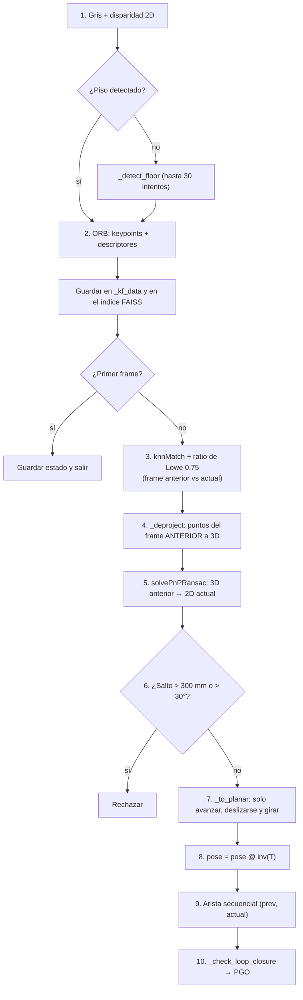

# Odometría visual: el mapa de `VisualOdometry.update()`

> [!info] Nivel 2 · Anterior: [[04 Mapa del codigo]] · Requisitos: [[Pose y matrices 4x4]], [[Camara estereo y disparidad]]

## Nivel 1: la idea

**Odometría** es medir cuánto te moviste. La de un coche cuenta vueltas de las llantas; la **visual** lo hace **comparando dos fotos seguidas**. Si una esquina de la mesa estaba a 1 m y ahora está a 0.9 m, avanzaste unos 10 cm.

El problema: cada paso tiene un error pequeño y **los errores se suman** (*drift*). Después de 500 pasos, el carro "cree" que está en otro lugar. Para eso existe el **loop closure**: reconocer que volviste a un lugar conocido y corregir.

## Nivel 2: qué pasa en cada frame

`update(frame, disp, frame_idx)` recibe la imagen izquierda rectificada y su disparidad:

| Paso | Qué hace | Nota que lo explica |
|---|---|---|
| 2 | Encuentra unas 1000 esquinas y les calcula una huella de 256 bits | [[ORB 1 Intuicion]], [[ORB 2 En el proyecto]] |
| 3 | Empareja las huellas del frame anterior con las del actual | [[ORB 6 Hamming y matching]] |
| 4 | Convierte los puntos del frame anterior a 3D con su disparidad | [[Camara estereo y disparidad]] |
| 5 | Encuentra la rotación y la traslación que mejor explican cómo se movieron esos puntos 3D en la imagen nueva | [[PnP RANSAC]] |
| 6 | Un carrito no avanza 30 cm en 1/30 de segundo: si lo hace, es un error | |
| 7 | Quita los movimientos imposibles para un carro en el piso | [[Movimiento plano]] |
| 8 | Acumula la pose | [[Pose y matrices 4x4]] |
| 10 | Si reconoce un lugar viejo, optimiza todas las poses | [[Loop closure y PGO]] |

> [!tip] ¿Por qué PnP con 3D↔2D y no 2D↔2D?
> Con una sola cámara, el movimiento solo se obtiene **sin escala**: no sabes si avanzaste 1 cm o 1 m. Como aquí el frame anterior ya tiene **profundidad real en mm** (gracias al estéreo), PnP devuelve la traslación **en mm reales**. Esa es la gran ventaja del estéreo.

## Cuando un frame falla (guía de depuración)

Cada salida temprana imprime un mensaje. Esto es lo que significa cada uno:

| Mensaje en consola | Causa probable | Qué revisar |
|---|---|---|
| `failed des < 8` | Casi no hay esquinas: imagen borrosa, oscura o pared lisa | Luz, velocidad del carro, `fastThreshold` |
| `failed matches < MIN_PNP_MATCHES` | Menos de 12 parejas pasaron el ratio de Lowe | Movimiento muy brusco o textura repetitiva |
| `failed valid.sum() < MIN_PNP_INLIERS` | Las parejas no tienen disparidad válida (≥ 2 px) | Puntos muy lejanos o RAFT falló |
| `failed not success or no inliers` | PnP no encontró 12 inliers consistentes | Muchas parejas falsas |
| `[VO] SALTO frame N` | PnP dio un movimiento imposible | Cuenta como fallo, igual que los demás |
| `[VO] 5 fallos seguidos: nueva referencia` | El último frame bueno quedó muy lejos | Ese hueco sí se pierde; si sale seguido, revisa luz y velocidad |

> [!success] Corregido (18-oct-2026): el movimiento de un frame fallido ya no se pierde
> **Antes:** cuando un frame fallaba, su pose se quedaba igual que la anterior, pero el frame se volvía la nueva referencia (`_save_state`). El siguiente frame se comparaba contra el fallido, así que **el movimiento de en medio no se contaba nunca** y el mapa quedaba "encogido".
>
> **Ahora** todos los fallos pasan por `_fallo()`:
> 1. El frame fallido **no** se vuelve la referencia: el siguiente frame se compara contra el **último frame bueno**, así que su movimiento sí se mide.
> 2. El frame fallido **se quita de `all_poses`**, para que no entre a la nube ni al grafo con una pose vieja.
> 3. Si se juntan `MAX_FALLOS = 5` fallos seguidos, se reinicia la referencia en ese frame. Solo entonces se pierde el movimiento del hueco (es inevitable: ya no comparten esquinas).
>
> | Frame | Resultado | Antes: se comparaba con | Ahora: se compara con |
> |---|---|---|---|
> | 10 | OK | 9 | 9 |
> | 11 | Falla | 10 | 10 |
> | 12 | OK | **11** (pierde 10→11) | **10** (mide 10→12 completo) |

## Parámetros principales

| Constante | Valor | Qué controla |
|---|---|---|
| `LOWE_RATIO` | 0.75 | Qué tan estricto es el matching |
| `MIN_PNP_MATCHES` / `MIN_PNP_INLIERS` | 12 / 12 | Mínimos para confiar en PnP |
| `PNP_ITERATIONS` | 200 | Intentos de RANSAC |
| `PNP_REPROJ_ERR` | 2.0 px | Tolerancia para ser inlier (pensada para 640×360) |
| `JUMP_MAX_TRANS` / `JUMP_MAX_ROT` | 300 mm / 30° | Detector de saltos |
| `MAX_FALLOS` | 5 | Fallos seguidos antes de reiniciar la referencia |
| `USE_LOOP_CLOSURE` | `False` | Loop closure apagado: producía loops falsos (ver [[ORB 6 Hamming y matching]]) |
| `USE_ICP` | `False` | ICP apagado: producía 0.79 m de recorrido falso con el carro quieto |
| `USE_PLANAR` | `True` | Restricción de movimiento plano |
