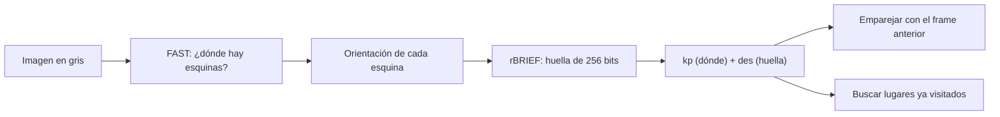

# ORB 1: Intuición

> [!info] Nivel 1 · Serie ORB: **1** · [[ORB 2 En el proyecto]] · [[ORB 3 FAST]] · [[ORB 4 Orientacion]] · [[ORB 5 rBRIEF]] · [[ORB 6 Hamming y matching]]

## ¿Para qué lo necesitamos?

Para saber cuánto se movió el carro entre dos fotos necesitamos **puntos que podamos reconocer en las dos**. ORB hace dos trabajos:

1. **Encontrar** puntos interesantes: las **esquinas**.
2. **Describir** cada punto con una **huella digital** para reconocerlo en la siguiente foto.

**ORB** = ***O**riented FAST and **R**otated **B**RIEF*. Su nombre dice de qué está hecho:

| Pieza | Trabajo | Analogía |
|---|---|---|
| **FAST** | Encuentra esquinas | Un turista que se fija en las esquinas de los edificios, no en las paredes lisas |
| **Oriented** | Calcula hacia dónde "apunta" cada esquina | Recordar "la esquina con la parte clara hacia arriba" |
| **BRIEF** | Saca la huella: 256 preguntas de sí/no | "¿Este punto es más claro que aquel?" ×256 |
| **Rotated** | Hace las preguntas girando según la orientación | Así la huella no cambia si el carro gira |

## ¿Por qué esquinas y no paredes?

> [!note] Si no recuerdas qué es un píxel o una intensidad de 0 a 255, lee primero [[Imagen digital]].

Imagina que miras por un tubo de papel (una ventanita pequeña) y alguien mueve la foto un poquito:

- **Pared lisa:** todo se ve igual. **No sabes** si se movió.
- **Borde** (orilla de una mesa): notas si se mueve perpendicular al borde, pero **no** si se desliza a lo largo de él.
- **Esquina:** **cualquier** movimiento se nota. Por eso es única y fácil de seguir.

## ¿Por qué una huella de sí/no?

Cada huella son **256 respuestas de sí/no (bits)**. Comparar dos huellas es contar **cuántas respuestas son distintas**: la **distancia de Hamming**. La computadora lo hace con una sola operación (XOR) y un conteo de bits, que es **muchísimo** más rápido que comparar números decimales. Por eso ORB sirve en tiempo real y en máquinas modestas.

## ¿Por qué "orientada" y con pirámide?

- Si el carro **gira**, la imagen gira. Sin orientación, las 256 preguntas se harían en otro ángulo y la huella cambiaría. Ver [[ORB 4 Orientacion]].
- Si el carro **se acerca**, los objetos se ven más grandes. ORB busca esquinas en varias versiones de la imagen, cada una más chica (una **pirámide**), para encontrar la misma esquina aunque cambie de tamaño. Ver [[ORB 3 FAST]].

## ¿Dónde lo usa el proyecto?

En cada frame, ORB encuentra hasta **1000 esquinas**, y con ellas se hacen tres cosas:

1. **Odometría:** emparejar las esquinas del frame anterior con las del actual para calcular el movimiento. Ver [[Odometria visual]].
2. **Loop closure:** reconocer un lugar visitado hace muchos frames, comparando huellas contra todo el historial.
3. **Nube sparse** (`reprocesar.py --sparse`): dibujar el mapa usando solo esas esquinas. Es rápido, para ver la forma general.

