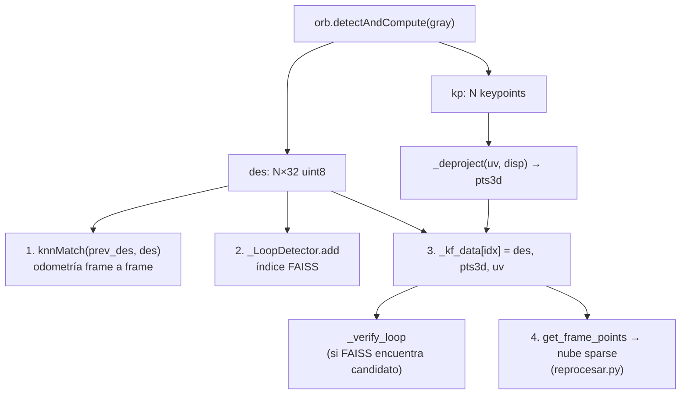

# ORB 2: ORB en el proyecto

> [!info] Nivel 2 · Serie ORB: [[ORB 1 Intuicion]] · **2** · [[ORB 3 FAST]] · [[ORB 4 Orientacion]] · [[ORB 5 rBRIEF]] · [[ORB 6 Hamming y matching]]

## Dónde se crea

En `VisualOdometry.__init__` (`visual_odometry.py`):

```python
# nlevels=6: para 640x360 la piramide de 8 niveles llega a ~80px (inutil)
# fastThreshold=10: detecta mas esquinas en zonas de poca textura
self.orb = cv2.ORB_create(
    nfeatures    = 1000,
    scaleFactor  = 1.2,
    nlevels      = 6,
    edgeThreshold= 19,
    patchSize    = 19,
    fastThreshold= 10,
)
# Sin crossCheck: usamos ratio test de Lowe con knnMatch (mas discriminativo)
self.matcher = cv2.BFMatcher(cv2.NORM_HAMMING)
```

## Cada parámetro, en simple

| Parámetro | Valor (default) | Qué significa | Explicación a fondo |
|---|---|---|---|
| `nfeatures` | **1000** (500) | Máximo de esquinas por imagen. Se quedan las de mejor puntaje Harris | [[ORB 3 FAST]] |
| `scaleFactor` | 1.2 (1.2) | Cada piso de la pirámide es 1.2 veces más chico | [[ORB 3 FAST]] |
| `nlevels` | **6** (8) | Cuántos pisos tiene la pirámide | [[ORB 3 FAST]] |
| `fastThreshold` | **10** (20) | Cuánto más clara u oscura (de 0 a 255) debe ser la vecindad para que haya esquina. Más bajo = más esquinas, pero también más ruido | [[ORB 3 FAST]] |
| `patchSize` | **19** (31) | Tamaño del parche, en píxeles, para la orientación y la huella | [[ORB 4 Orientacion]], [[ORB 5 rBRIEF]] |
| `edgeThreshold` | **19** (31) | Margen del borde de la imagen donde no se buscan esquinas (el parche no cabría). Debe ser ≈ `patchSize` | [[ORB 3 FAST]] |
| `WTA_K` | 2 (no se cambia) | Cada bit compara 2 píxeles. Por eso se usa `NORM_HAMMING` | [[ORB 5 rBRIEF]] |
| `scoreType` | Harris (no se cambia) | Cómo se elige a las "mejores" esquinas | [[ORB 3 FAST]] |

## Qué devuelve `detectAndCompute`

```python
kp, des = self.orb.detectAndCompute(gray, None)
```

- **`kp`**: lista de objetos `cv2.KeyPoint` (el "dónde"):

| Atributo | Qué es | Ejemplo |
|---|---|---|
| `pt` | (u, v) en píxeles del nivel 0, con decimales | `(812.4, 233.0)` |
| `octave` | En qué piso de la pirámide se encontró | `2` |
| `size` | Diámetro de la zona usada: `patchSize · 1.2^octave` | `27.4` |
| `angle` | Orientación en grados (0 a 360) | `147.2` |
| `response` | Puntaje Harris (más alto = mejor esquina) | `0.0012` |

- **`des`**: arreglo `np.uint8` de forma **(N, 32)** (la huella). 32 bytes = **256 bits** por esquina. Es `None` si no hubo esquinas.

## Los cuatro caminos de los datos ORB



1. **Odometría:** `knnMatch(self.prev_des, des, k=2)` + ratio de Lowe. Ver [[ORB 6 Hamming y matching]].
2. **Índice de lugares:** todas las huellas se agregan a FAISS para buscar loops después. Ver [[ORB 6 Hamming y matching]].
3. **Memoria del frame:** se guardan huellas + puntos 3D + (u, v), **unos 50 KB por frame**. Antes se guardaba la disparidad completa (3.7 MB por frame).
4. **Nube sparse:** `reprocesar.py` toma los puntos 3D de cada esquina y los pone en el mundo.

> [!warning] Detalle que confunde: `queryIdx` y `trainIdx`
> En `knnMatch(A, B)`, el **query** es A y el **train** es B. En la odometría, A es el frame **anterior**:
> ```python
> pts_prev_2d = [self.prev_kp[m.queryIdx].pt for m in matches]  # anterior
> pts_curr_2d = [kp[m.trainIdx].pt           for m in matches]  # actual
> ```
> Si los volteas, PnP calcula el movimiento al revés y el carro "camina hacia atrás".

## Filtro de bordes de profundidad en la nube sparse

FAST detecta esquinas, y muchas caen **justo en la frontera** entre un objeto cercano y el fondo. Ahí la disparidad salta, y el punto 3D queda "flotando" entre los dos. `reprocesar.py` los descarta si la disparidad cambia más de 2 px en una ventana de 5×5:

```python
rango = cv2.dilate(disp, k) - cv2.erode(disp, k)   # max - min en 5x5
m = ... & (rango[v, u] < EDGE_MAX_DISP)            # EDGE_MAX_DISP = 2.0 px
```

*dilate* = máximo local y *erode* = mínimo local en la ventana. Su resta es el **gradiente morfológico**: cuánto cambia la disparidad alrededor del punto.

## Cómo se reparten las 1000 esquinas en la pirámide (stream de 1280×720)

OpenCV no busca 1000 esquinas en cada piso; las reparte, y a los pisos más chicos les tocan menos (la fórmula está en [[ORB 3 FAST]]):

| Piso (`octave`) | Escala | Tamaño de la imagen | Esquinas máximas |
|---|---|---|---|
| 0 | 1.00 | 1280 × 720 | 251 |
| 1 | 1.20 | 1067 × 600 | 209 |
| 2 | 1.44 | 889 × 500 | 174 |
| 3 | 1.73 | 741 × 417 | 145 |
| 4 | 2.07 | 617 × 347 | 121 |
| 5 | 2.49 | 514 × 289 | 100 |
| | | **Total** | **1000** |

> [!warning] Revisión: los parámetros se ajustaron para 640×360
> El comentario de `nlevels=6` dice que, a 640×360, el último piso sería inútil. Pero **ahora cada lente da 1280×720**: con 8 pisos, el último mediría 357×201, que todavía es útil. Además, 1000 esquinas en 4 veces más píxeles quedan **más dispersas**.
> Experimento sugerido, con `reprocesar.py --sparse` sobre la misma sesión: compara `nlevels` 6 contra 8 y `nfeatures` 1000 contra 2000, y mira la cobertura (`VO: X/Y frames con pose valida`) y el tiempo por frame. Cambia **un parámetro a la vez**.
