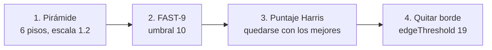

# ORB 3: FAST, Harris y la pirámide (el detector)

> [!info] Nivel 3 · Serie ORB: [[ORB 1 Intuicion]] · [[ORB 2 En el proyecto]] · **3** · [[ORB 4 Orientacion]] · [[ORB 5 rBRIEF]] · [[ORB 6 Hamming y matching]]

El detector responde **"¿dónde hay esquinas?"** en cuatro pasos:



## 1. La pirámide de imágenes

Para encontrar la misma esquina aunque el carro se acerque, se repite la búsqueda en versiones cada vez más chicas de la imagen. El piso $\ell$ tiene escala $s^\ell$ con $s = 1.2$:

$$
\text{ancho}_\ell = \frac{1280}{1.2^\ell}, \qquad \text{alto}_\ell = \frac{720}{1.2^\ell}, \qquad \ell = 0, \dots, 5
$$

Una esquina encontrada en el piso $\ell$ en la posición $(u_\ell, v_\ell)$ se reporta en coordenadas del piso 0: $(u, v) = s^\ell\,(u_\ell, v_\ell)$. Por eso `kp.pt` siempre está en píxeles de la imagen original.

### ¿Cuántas esquinas le tocan a cada piso?

OpenCV reparte `nfeatures` = N de forma que cada piso recibe $r = 1/s$ veces lo del anterior. La suma debe dar N:

$$
n_0\,(1 + r + r^2 + \dots + r^{L-1}) = N
\quad\Longrightarrow\quad
n_0 = N\,\frac{1 - r}{1 - r^{L}}
$$

Con $N = 1000$, $r = 1/1.2 = 0.8\overline{3}$ y $L = 6$:

$$
n_0 = 1000 \cdot \frac{0.1667}{1 - 0.8333^6} = 1000 \cdot \frac{0.1667}{0.6651} \approx 251
$$

y luego 209, 174, 145, 121 y 100 (el último piso recibe lo que sobra). Ver la tabla en [[ORB 2 En el proyecto]].

## 2. FAST: la prueba del círculo

(Intensidades de 0 a 255 en escala de grises; ver [[Imagen digital]].)

Para cada píxel candidato $p$ con intensidad $I_p$, se miran **16 píxeles en un círculo de radio 3** (círculo de Bresenham):

```
 .   .  16   1   2   .   .
 .  15   .   .   .   3   .
14   .   .   .   .   .   4
13   .   .   p   .   .   5
12   .   .   .   .   .   6
 .  11   .   .   .   7   .
 .   .  10   9   8   .   .
```

**Regla FAST-9:** $p$ es esquina si existen **9 píxeles contiguos** del círculo que sean todos:

$$
\text{más claros:}\ I_i > I_p + t \qquad\text{o}\qquad \text{todos más oscuros:}\ I_i < I_p - t
$$

con $t$ = `fastThreshold` = **10**.

> [!example] Ejemplo numérico
> $I_p = 100$ y $t = 10$, así que "claro" es > 110 y "oscuro" es < 90.
>
> | Posición | 1 | 2 | 3 | 4 | 5 | 6 | 7 | 8 | 9 | 10 | 11 | 12 | 13 | 14 | 15 | 16 |
> |---|---|---|---|---|---|---|---|---|---|---|---|---|---|---|---|---|
> | $I_i$ | 150 | 148 | 140 | 135 | 130 | 120 | 118 | 115 | 112 | 95 | 92 | 100 | 98 | 105 | 120 | 145 |
> | ¿Claro? | ✔ | ✔ | ✔ | ✔ | ✔ | ✔ | ✔ | ✔ | ✔ | | | | | | ✔ | ✔ |
>
> El círculo es **cerrado**, así que 15 → 16 → 1 → … → 9 forman una racha de **11 claros seguidos**. Como 11 ≥ 9, **$p$ es esquina**: una zona oscura "entra" a una zona clara.
>
> Con $t = 30$ ("claro" > 130), solo cuentan 16, 1, 2, 3 y 4 (130 no es mayor que 130): una racha de 5. **No sería esquina.** Así funciona `fastThreshold`.

¿Por qué 9 de 16? Un **borde recto** deja aproximadamente la mitad del círculo (8) de un lado. Pedir 9 o más contiguos exige un ángulo **más cerrado que 180°**, es decir, una esquina.

## 3. Puntaje Harris: elegir a las mejores

FAST encuentra demasiados candidatos. Para quedarse con los mejores, OpenCV:

1. Hace *non-maximum suppression* (de un grupo de esquinas pegadas, conserva la más fuerte).
2. Conserva el doble de lo que le toca al piso, según el puntaje FAST.
3. Calcula el **puntaje Harris** en una ventana de 7×7 y conserva las $n_\ell$ mejores.

### Derivación de Harris

¿Cuánto cambia la ventana $W$ si la muevo $(\Delta u, \Delta v)$?

$$
E(\Delta u, \Delta v) = \sum_{(u,v)\in W} \big[I(u+\Delta u, v+\Delta v) - I(u,v)\big]^2
$$

Con Taylor de primer orden, $I(u+\Delta u, v+\Delta v) \approx I + I_u\Delta u + I_v \Delta v$:

$$
E \approx \begin{bmatrix}\Delta u & \Delta v\end{bmatrix}
\underbrace{\sum_W \begin{bmatrix} I_u^2 & I_u I_v \\ I_u I_v & I_v^2 \end{bmatrix}}_{M}
\begin{bmatrix}\Delta u \\ \Delta v\end{bmatrix}
$$

Los **eigenvalores** $\lambda_1, \lambda_2$ de $M$ dicen qué tan rápido cambia la ventana en cada dirección:

| $\lambda_1$ | $\lambda_2$ | Zona |
|---|---|---|
| pequeño | pequeño | Plana (pared lisa) |
| grande | pequeño | Borde |
| **grande** | **grande** | **Esquina** |

Para no calcular eigenvalores (es caro), Harris usa:

$$
R = \det M - k\,(\operatorname{tr} M)^2 = \lambda_1\lambda_2 - k(\lambda_1 + \lambda_2)^2,\qquad k = 0.04
$$

$R$ es grande solo si **ambos** eigenvalores son grandes. Ese valor es `kp.response`.

## 4. El margen (`edgeThreshold`)

Las esquinas a menos de `edgeThreshold = 19` px del borde se descartan, porque el parche de 19×19 de la orientación y la huella no cabría completo. Por eso `edgeThreshold` debe ser **≥ `patchSize`**.
