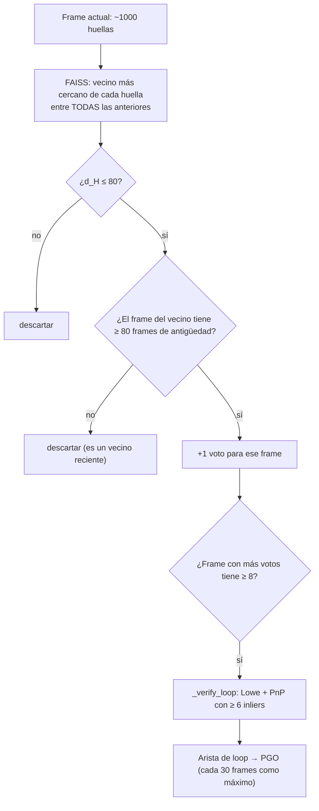

# ORB 6: Distancia de Hamming, matching y búsqueda de lugares

> [!info] Nivel 2 → 3 · Serie ORB: [[ORB 1 Intuicion]] · [[ORB 2 En el proyecto]] · [[ORB 3 FAST]] · [[ORB 4 Orientacion]] · [[ORB 5 rBRIEF]] · **6**

## Nivel 1: comparar huellas

Dos huellas de 256 bits se comparan **contando cuántos bits son distintos**. A eso se le llama **distancia de Hamming**:

- 0 = idénticas
- 256 = opuestas
- ≈ 128 = no tienen nada que ver (es lo que dan dos huellas al azar)

## Nivel 3: XOR + popcount

$$
d_H(\mathbf{a}, \mathbf{b}) = \operatorname{popcount}(\mathbf{a} \oplus \mathbf{b})
$$

El XOR ($\oplus$) da 1 justo donde los bits difieren, y *popcount* cuenta los unos. El CPU tiene instrucciones para ambas, así que comparar 32 bytes cuesta unos pocos ciclos.

> [!example] Ejemplo con un byte
> ```
> a       = 1011 0010   (178)
> b       = 1001 1011   (155)
> a XOR b = 0010 1001   -> tres unos -> d_H = 3
> ```
> Con las huellas completas se hace lo mismo para los 32 bytes y se suman los conteos.

### ¿Qué distancia es "parecida"?

Si dos huellas son independientes y cada bit vale 1 con probabilidad 0.5, la distancia sigue una **binomial** $B(256, 0.5)$:

$$
\mu = 256 \cdot 0.5 = 128, \qquad \sigma = \sqrt{256 \cdot 0.5 \cdot 0.5} = 8
$$

Una distancia de **80** está $(128 - 80)/8 = 6\sigma$ por debajo de lo esperado entre huellas al azar. Por eso el detector de loops usa `LC_HAMMING_MAX = 80`: es muy improbable que una pareja así sea casualidad. Eso sí, este modelo **supone huellas al azar**; en la práctica, texturas parecidas (losetas, cortinas) sí producen distancias bajas sin ser el mismo punto.

## Nivel 2: matching frame a frame (odometría)

```python
raw = self.matcher.knnMatch(self.prev_des, des, k=2)   # 2 mejores candidatos
matches = [
    pair[0] for pair in raw
    if len(pair) == 2 and pair[0].distance < LOWE_RATIO * pair[1].distance
]
```

1. **`BFMatcher(NORM_HAMMING)`** (*brute force*) compara **cada** huella del frame anterior contra **todas** las del actual: con 1000 × 1000, un millón de distancias por frame.
2. **`knnMatch(k=2)`** devuelve, para cada huella anterior, su **mejor** ($d_1$) y su **segundo mejor** ($d_2$) candidato.
3. **Ratio de Lowe:** se acepta solo si

$$
d_1 < 0.75\, d_2
$$

| $d_1$ | $d_2$ | ¿$d_1 < 0.75\,d_2$? | Decisión | Interpretación |
|---|---|---|---|---|
| 30 | 70 | 30 < 52.5 ✔ | **Aceptar** | Un ganador claro |
| 40 | 48 | 40 < 36 ✘ | **Rechazar** | Dos candidatos casi iguales, probablemente una textura repetida |
| 90 | 100 | 90 < 75 ✘ | **Rechazar** | Ninguno se parece en realidad |

> [!tip] ¿Por qué un ratio y no un umbral fijo?
> Un umbral fijo ("acepta si $d_1 < 50$") deja pasar parejas en losetas repetidas, donde **todas** las candidatas están cerca. El ratio pregunta otra cosa: **¿el ganador es mucho mejor que el segundo lugar?** El comentario del código explica que por eso no se usa `crossCheck`.

Las parejas que sobreviven van a `solvePnPRansac`, que todavía descarta las erróneas que se colaron (*outliers*). Ver [[VO 4 PnP RANSAC]].

## Nivel 2: búsqueda de lugares visitados (`_LoopDetector`)

Resumen; el detalle (votos, por qué estaba muerto, verificación y PGO) está en la serie [[LC 1 Intuicion|Loop closure]], sobre todo en [[LC 3 Deteccion de candidatos]].

```python
self.index = faiss.IndexBinaryFlat(256)     # indice binario exacto
```



| Constante | Valor | Para qué |
|---|---|---|
| `LC_HAMMING_MAX` | 80 | Calidad mínima de un voto (6σ) |
| `MIN_LOOP_SEP` | 80 frames | No confundir "el frame de hace un momento" con un loop |
| `MIN_LOOP_VOTES` | 8 | Mínimo de votos para considerar un candidato |
| `MIN_LOOP_INLIERS` | 6 | Verificación geométrica con PnP |
| `LOOP_PGO_COOLDOWN` | 30 | No repetir el PGO en cada frame |

> [!success] Corregido (18-oct-2026): al índice solo entran keyframes
> **Antes:** cada frame agregaba sus ~1000 huellas y nunca se borraban. Después de $F$ frames el índice tenía unas $1000F$ huellas, y **cada** consulta comparaba 1000 huellas contra todas ellas:
>
> $$\text{costo de la consulta } F \approx 1000 \cdot 1000F = 10^6 F
> \qquad
> \text{costo total} \approx \sum_{k=1}^{F} 10^6 k \approx 5\times10^{5}\,F^2$$
>
> Es decir, **O(F²)**. Además, con el carro quieto se llenaba de copias casi iguales.
>
> **Ahora** `_add_loop_keyframe()` agrega las huellas solo si el carro avanzó **≥ 50 mm** o giró **≥ 5°** desde el último keyframe agregado (`LC_KF_MOV_MM`, `LC_KF_ROT_DEG`), el mismo criterio que la nube densa. Los frames fallidos tampoco entran, porque no tienen pose confiable. Sigue siendo O(F²) con respecto a los keyframes, pero hay muchos menos keyframes que frames, y estar quieto ya no cuesta nada.
>
> Si algún día las sesiones son muy largas, el siguiente paso sería *bag of words* (DBoW2, como ORB-SLAM): un **índice invertido**: por cada "palabra visual" guarda en qué frames aparece.

> [!danger] Hallazgo (18-oct-2026): el loop closure estaba muerto, y al revivirlo produce loops falsos
> **Estaba muerto:** FAISS busca solo el vecino más cercano (`k=1`). Con todos los frames en el índice, ese vecino casi siempre era un frame **reciente** (menos de 80 frames atrás) y se descartaba. En `session_20261018_114813` hubo 476 mil huellas en el índice y **0 loops**.
>
> **Al revivirlo** (solo keyframes en el índice) aparecieron 20 loops, varios **falsos**. Por ejemplo, 85→180 con una rotación de 142°: imposible si las dos vistas comparten escena, porque la cámara solo ve unos 72° de ancho. Con solo 6 inliers, PnP no basta para verificar, y el PGO, sin pérdida robusta, se desarmó: el recorrido pasó de **4 m a 90 m**.
>
> **Por eso ahora `USE_LOOP_CLOSURE = False` por default.** Para experimentar: `python reprocesar.py --loops`. Arreglarlo de verdad requiere una verificación más estricta (más inliers y comparar contra la odometría) y una pérdida robusta en `least_squares` (`loss='huber'`).

| Constante nueva | Valor | Para qué |
|---|---|---|
| `LC_KF_MOV_MM` | 50 mm | Avance mínimo para agregar un keyframe al índice |
| `LC_KF_ROT_DEG` | 5° | O giro mínimo |
| `USE_LOOP_CLOSURE` | `False` | Loop closure apagado hasta mejorar la verificación |
