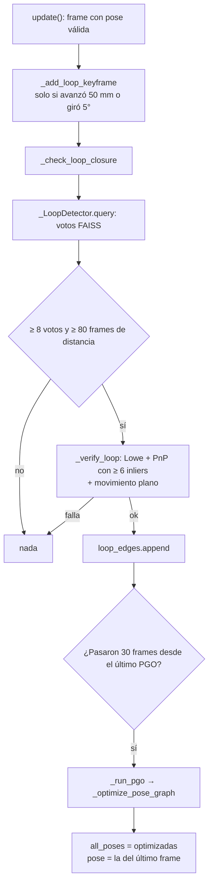

# Loop closure y PGO

> [!info] Nivel 1 → 3 · Requisitos: [[Odometria visual]], [[ORB 6 Hamming y matching]], [[PnP RANSAC]], [[Pose y matrices 4x4]]

> [!warning] Estado al 18-oct-2026: apagado
> `USE_LOOP_CLOSURE = False`. Se prende solo para experimentar con `python reprocesar.py --loops`. Los motivos están en [[#Hallazgos]].

## Nivel 1: la idea

La odometría acumula error (*drift*). Si el carro regresa a un lugar por donde ya pasó y lo **reconoce**, obtiene un dato extra: "estoy a tal distancia de donde estaba en el frame 85". Con ese dato se puede corregir **todo** el camino, no solo el último paso.

Piensa en resortes: cada pose es un nudo y cada medición (un paso de odometría o un loop) es un resorte que quiere tener cierta longitud. El **PGO** (*Pose Graph Optimization*) mueve los nudos hasta que los resortes quedan lo menos estirados posible. Un resorte más rígido (más peso) se respeta más.

## Nivel 2: el flujo en el código

La búsqueda en FAISS y los votos están en [[ORB 6 Hamming y matching]]. Aquí está lo que pasa después.

### El grafo

| Elemento | En el código | Qué es |
|---|---|---|
| Nodos | `all_poses` = `{frame: 4x4}` | Pose cámara → mundo de cada frame con pose válida |
| Aristas secuenciales | `seq_edges` = `[(i, j, T_ij)]` | Lo que midió la odometría entre frames seguidos. Peso 1 |
| Aristas de loop | `loop_edges` = `[(a, b, T_ab)]` | Lo que midió `_verify_loop` entre dos frames lejanos en el tiempo. Peso `PGO_WEIGHT_LOOP = 5` |

La convención de las aristas es $T_{ij} = P_i^{-1} P_j$: "dónde está $j$ visto desde $i$". PnP entrega lo contrario (lleva puntos de $a$ a $b$), por eso `_verify_loop` invierte su resultado.

### Constantes

| Constante | Valor | Qué controla |
|---|---|---|
| `MIN_LOOP_SEP` | 80 frames | Separación mínima en el tiempo para considerar un loop |
| `MIN_LOOP_VOTES` | 8 | Votos FAISS mínimos |
| `MIN_LOOP_INLIERS` | 6 | Inliers de PnP para aceptar el loop |
| `LOOP_PGO_COOLDOWN` | 30 frames | No repetir PGO ni el mismo loop muy seguido |
| `PGO_WEIGHT_LOOP` | 5.0 | Cuánto más pesa un loop que un paso de odometría |
| `PGO_ROT_SIGMA_DEG` | 1.0° | Error de rotación "normal" por arista |
| `PGO_TRANS_SIGMA` | 10 mm | Error de traslación "normal" por arista |
| `PGO_MAX_ITER` | 50 | Evaluaciones máximas de `least_squares` |

### `_optimize_pose_graph` paso a paso

1. **Fija la primera pose.** Si todas fueran variables, el mapa completo podría moverse o girar junto sin cambiar el error: habría infinitas soluciones.
2. **Variables:** 6 números por cada otra pose (`mat_to_vec`: Rodrigues + traslación). Con 487 frames son $486 \times 6 = 2916$ incógnitas.
3. **Residuos:** 6 por arista (ver nivel 3).
4. **Resuelve** con `least_squares(method='trf', x_scale='jac', max_nfev=50, jac_sparsity=...)`.
5. **Regresa** las poses optimizadas; `_run_pgo` reemplaza `all_poses` y pone `self.pose` igual a la del último frame.

> [!note] Sin loops, el PGO no cambia nada
> Si solo hay aristas secuenciales, la odometría ya las cumple todas exactamente (residuo 0). El PGO solo mueve poses cuando un loop contradice a la odometría.

## Nivel 3: las matemáticas

### El residuo de una arista

Para la arista $(i, j)$ con medición $T_{ij}$ y poses estimadas $P_i, P_j$:

$$
E_{ij} = T_{ij}^{-1}\, P_i^{-1}\, P_j
$$

Si la estimación coincide con la medición, $E_{ij} = I$. Los 6 residuos son el giro y la traslación de $E_{ij}$, divididos entre su sigma y multiplicados por $\sqrt{w}$:

$$
\mathbf{r}_{ij} = \sqrt{w}\begin{bmatrix} \operatorname{rvec}(E_{ij}) / \sigma_{rot} \\ \mathbf{t}(E_{ij}) / \sigma_t \end{bmatrix},
\qquad
\text{costo} = \sum_{(i,j)} \lVert \mathbf{r}_{ij} \rVert^2
$$

Sin dividir entre las sigmas, 1 mm de error pesaría lo mismo que 1 radián (57°), y las traslaciones dominarían. Con $\sigma_{rot} = 1°$ y $\sigma_t = 10$ mm, **1° de error de giro cuesta lo mismo que 10 mm de traslación**.

> [!example] Ejemplo en una dimensión
> El carro avanza tres tramos. La odometría mide 100 mm en cada uno, así que $x_3 = 300$. Un loop dice que en realidad $x_3 - x_0 = 270$. Con $x_0 = 0$ fijo, por simetría los tres tramos quedan iguales ($d$), y el costo es
>
> $$f(d) = 3\,(d - 100)^2 + w\,(3d - 270)^2$$
>
> Derivando e igualando a cero: $d = \dfrac{600 + 1620\,w}{6 + 18\,w}$.
>
> | Caso | Cada tramo | $x_3$ |
> |---|---|---|
> | Solo odometría | 100 mm | 300 mm |
> | Loop con peso 1 | 92.5 mm | 277.5 mm |
> | Loop con peso 5 (el del código) | 90.6 mm | 271.9 mm |
>
> El error de 30 mm **se reparte entre los tres tramos** en vez de cargarse todo al último, y el peso decide a quién se le cree más.

### El jacobiano disperso (`jac_sparsity`)

`least_squares` necesita el jacobiano: cuánto cambia cada residuo al mover cada variable. Con 2916 residuos y 2916 variables son unos 8.5 millones de entradas, pero cada arista depende solo de **2 poses** (12 columnas), así que casi todas son cero.

- Sin esa información, scipy estimaría el jacobiano moviendo una variable a la vez: 2916 evaluaciones de todos los residuos.
- Con `jac_sparsity`, scipy agrupa las columnas que no comparten filas y las mueve juntas: unas 12 a 18 evaluaciones.

### Pérdida robusta (pendiente)

Con mínimos cuadrados normales, el costo de un residuo es $r^2$. Un loop **falso** con error de 100 sigmas aporta $100^2 = 10{,}000$ (por 5 de peso, 50,000) y arrastra a todo el mapa. Con la pérdida de Huber (`loss='huber'`, `f_scale=1`), scipy aplica a cada residuo:

$$
\rho(s) = \begin{cases} s & s \le 1 \\ 2\sqrt{s} - 1 & s > 1 \end{cases}, \qquad s = r^2
$$

Para $r = 100$: $\rho = 2 \cdot 100 - 1 = 199$ en lugar de 10,000. Los errores chicos se tratan igual que antes y los enormes pierden fuerza.

## Hallazgos

### 1. El loop closure estaba muerto, y al revivirlo dio loops falsos

Resumen (el detalle está en [[ORB 6 Hamming y matching]]):

- **Muerto:** FAISS busca solo el vecino más cercano (`k=1`), que casi siempre era un frame reciente y se descartaba. En `session_20261018_114813`: 476 mil huellas y 0 loops.
- **Falsos al revivirlo** (solo keyframes en el índice): por ejemplo 85→180 con un giro de 142°. Con un campo de visión de unos 70°, dos vistas giradas 142° no pueden compartir escena. Con 6 inliers PnP no basta para verificar, y el PGO sin pérdida robusta se desarmó: el recorrido pasó de **4 m a 90 m**.

### 2. El grafo queda partido después de 5 fallos seguidos

Cuando `_fallo()` reinicia la referencia (`MAX_FALLOS = 5`), el frame del reinicio conserva la última pose conocida, pero **ninguna arista lo une con el último frame bueno**. El siguiente frame bueno sí se une a él, así que el grafo queda en dos pedazos.

- **Sin loops:** no pasa nada, porque el PGO no mueve poses.
- **Con loops:** el pedazo de después del reinicio no está anclado a la primera pose. Un loop entre los dos pedazos lo puede mover como quiera.

Propuesta: al reiniciar, agregar una arista débil del último frame bueno al frame del reinicio con la identidad ("no sé cuánto me moví, probablemente poco"). Para que sea débil necesita su propio peso, por ejemplo una tercera lista de aristas con peso bajo.

### 3. Qué falta para volver a prenderlo

1. **Más inliers** en `_verify_loop` (por ejemplo 30 en lugar de 6).
2. **Consistencia con la odometría:** comparar el giro de $T_{ab}$ del loop con el que predice la odometría ($P_a^{-1} P_b$). Con el movimiento plano, el giro casi no deriva; si difieren más de unos 30°, rechazar. Esto habría tumbado el loop 85→180.
3. **Exigir que el loop se repita** en varios frames seguidos antes de aceptarlo.
4. **`loss='huber'`** en `least_squares`.
5. **Medir:** recorrido total y error final contra una corrida sin loops, igual que en la prueba de frames negros de [[Odometria visual]].

Detalle menor: después del PGO, `_last_lc_pose` (la referencia para agregar keyframes al índice) no se actualiza con las poses optimizadas.
