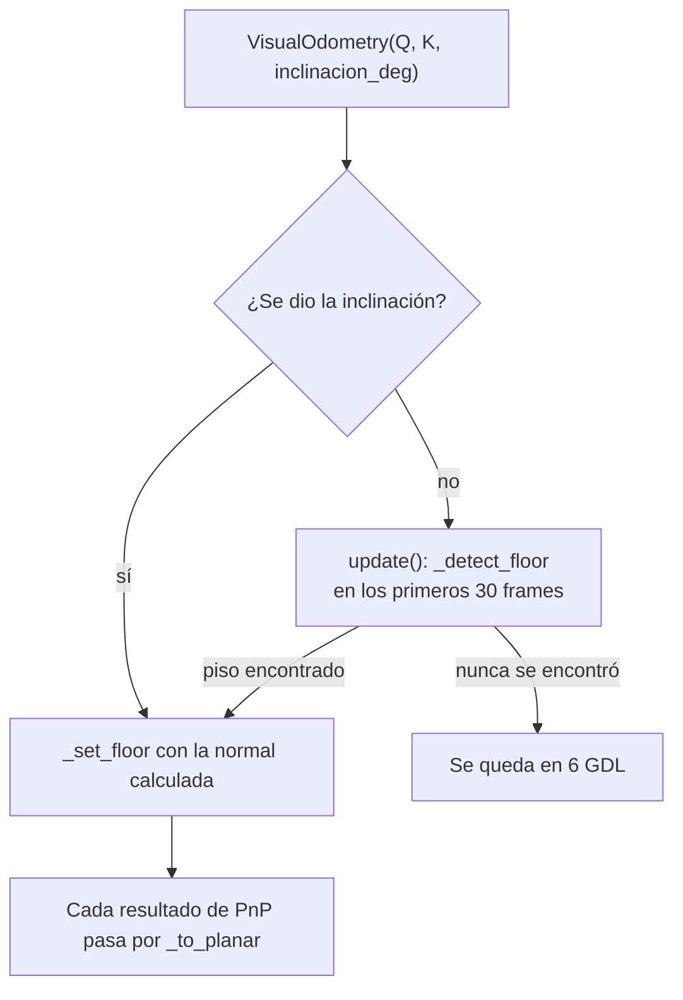

# Movimiento plano: el carro no vuela

> [!info] Nivel 1 → 3 · Requisitos: [[Pose y matrices 4x4]], [[PnP RANSAC]] · Lo usa: [[Odometria visual]] (paso 7)

## Nivel 1: la idea

Una pose libre tiene **6 grados de libertad** (GDL): 3 de posición y 3 de giro. Un carro sobre el piso solo usa 3:

| Movimiento | Eje (sistema del piso) | ¿Lo puede hacer el carro? |
|---|---|---|
| Avanzar / retroceder | Z | Sí |
| Deslizarse de lado | X | Sí (poco, al girar) |
| Girar sobre sí mismo (*yaw*) | giro sobre Y | Sí |
| Subir / bajar | Y | **No** |
| Cabecear (*pitch*) | giro sobre X | **No** |
| Alabear (*roll*) | giro sobre Z | **No** |

PnP no sabe que el carro va pegado al piso. En cada paso mete errores pequeños en los 3 movimientos imposibles y, como la odometría los suma, después de cientos de frames el carro "se hunde" o "despega". La restricción plana **borra esos tres componentes en cada paso**, antes de acumular la pose.

## Nivel 2: en el código

| Constante | Valor | Qué controla |
|---|---|---|
| `USE_PLANAR` | `True` | Prende la restricción |
| `FLOOR_BAND` | 0.35 | Se busca el piso en el 35 % de abajo de la imagen |
| `FLOOR_Z_MAX` | 2000 mm | Solo piso cercano, que es más preciso |
| `FLOOR_RANSAC_MM` | 10 mm | Distancia máxima al plano para ser inlier |
| `FLOOR_MIN_RATIO` | 0.4 | Mínimo 40 % de inliers para aceptar el plano |
| `FLOOR_MAX_TRIES` | 30 | Frames en los que se intenta detectar el piso |



### ¿De dónde sale la inclinación?

| Lugar | Cómo |
|---|---|
| `client_2.py` | `INCLINACION_CAMARA = None` → detectar el piso. Se guarda en `session_info.json` |
| `reprocesar.py` | `--inclinacion 12` (grados, + = cámara hacia arriba). Si no se da, usa la de `session_info.json` y, si es `None`, detecta |
| `reprocesar.py --sin-plano` | Apaga la restricción para comparar contra 6 GDL |

Cuando se define el piso, la consola imprime `[VO] Movimiento plano (...): inclinacion +X grados, alabeo +Y grados`. Si `reprocesar.py` no lo encuentra y la trayectoria tiene giros, sugiere un valor de `--inclinacion` a partir de la forma de la trayectoria.

### Dónde se aplica

En `update()`, después de PnP:

```python
# T mapea puntos prev->curr; el movimiento de la camara es su inversa
T = np.linalg.inv(self._to_planar(np.linalg.inv(T)))
```

`_to_planar` trabaja con el **movimiento de la cámara** (la inversa de $T$), lo aplana y se vuelve a invertir para seguir con la convención de PnP. `_verify_loop` aplica lo mismo a las aristas de loop ([[Loop closure y PGO]]).

### Paso 1: detectar el piso (`_detect_floor`)

1. Toma la franja de abajo (35 %) de la disparidad, **un píxel de cada 4** en cada dirección.
2. Convierte a 3D con Q los que tienen `disp > 2` y se queda con $100 < Z < 2000$ mm. Necesita al menos 500 puntos.
3. **RANSAC de plano:** 200 intentos. Cada uno toma 3 puntos, calcula la normal con un producto cruz y cuenta cuántos puntos quedan a menos de 10 mm del plano.
4. Acepta el mejor plano solo si tiene **≥ 40 %** de inliers.
5. **Refina** la normal con todos los inliers usando SVD.
6. Orienta la normal hacia abajo ($n_y > 0$, como el eje Y de la cámara) y exige $n_y \ge 0.7$. Si el plano está más inclinado que unos 45°, no es piso (puede ser una pared).
7. Llama a `_set_floor`.

La semilla del azar es fija (`default_rng(0)`): con los mismos datos, el resultado siempre es el mismo.

### Paso 2: el sistema del piso (`_set_floor`)

Con $\mathbf{n}$ = normal del piso hacia abajo, en coordenadas de la cámara:

$$
\mathbf{y}_f = \mathbf{n}, \qquad
\mathbf{z}_f = \frac{\hat{\mathbf{z}} - (\mathbf{n}\cdot\hat{\mathbf{z}})\,\mathbf{n}}{\lVert \cdot \rVert}, \qquad
\mathbf{x}_f = \mathbf{y}_f \times \mathbf{z}_f, \qquad
A = \begin{bmatrix} \mathbf{x}_f^\top \\ \mathbf{y}_f^\top \\ \mathbf{z}_f^\top \end{bmatrix}
$$

- $\mathbf{z}_f$ es el frente de la cámara "aplastado" sobre el piso.
- $A$ convierte vectores de la cámara al sistema del piso: $\mathbf{v}_{piso} = A\,\mathbf{v}_{cam}$. Como es una rotación, $A^\top$ regresa.
- También calcula `inclinacion_deg` $= \arcsin(-n_z)$ y `alabeo_deg` $= \arcsin(n_x)$.

> [!example] Ejemplo: cámara inclinada 12° hacia arriba, sin alabeo
> El "abajo" del mundo, visto desde la cámara, es $\mathbf{n} = (0, \cos 12°, -\sin 12°) = (0, 0.978, -0.208)$.
> - $\mathbf{z}_f = (0,0,1) + 0.208\,\mathbf{n} = (0, 0.203, 0.957)$, que normalizado da $(0, 0.208, 0.978)$.
> - $\mathbf{x}_f = \mathbf{y}_f \times \mathbf{z}_f = (0.978 \cdot 0.978 + 0.208 \cdot 0.208,\ 0,\ 0) = (1, 0, 0)$.
> - Inclinación: $\arcsin(0.208) = 12°$. Correcto.

### Paso 3: aplanar (`_to_planar`)

Recibe $M$, el movimiento de la cámara entre dos frames:

1. Lo pasa al sistema del piso: $R' = A\,R\,A^\top$, $\mathbf{t}' = A\,\mathbf{t}$.
2. Se queda con el giro sobre Y: $\psi = \operatorname{atan2}(R'_{02} - R'_{20},\ R'_{00} + R'_{22})$.
3. Arma $R_p = R_y(\psi)$ y $\mathbf{t}_p = (t'_x,\ 0,\ t'_z)$: sin subir ni bajar.
4. Regresa al sistema de la cámara: $A^\top R_p A$ y $A^\top \mathbf{t}_p$.

> [!example] Ejemplo: lo que se borra en un paso
> Cámara a nivel ($A = I$). PnP dice: giro de 10° sobre Y más 1° de cabeceo, y $\mathbf{t} = (3, -4, 120)$ mm.
> - El yaw que sale de la fórmula es ≈ 10°; el cabeceo de 1° desaparece.
> - $\mathbf{t}_p = (3, 0, 120)$: se borran 4 mm de "subida".
>
> 4 mm por paso parece poco, pero en 500 frames serían **2 m** de subida falsa.

## Nivel 3: de dónde salen las fórmulas

### La normal por SVD

Se busca la normal $\mathbf{n}$ (con $\lVert\mathbf{n}\rVert = 1$) que minimiza la suma de distancias al cuadrado de los inliers $\mathbf{q}_i$ al plano que pasa por su centro $\mathbf{c}$:

$$
\min_{\lVert\mathbf{n}\rVert = 1} \sum_i \big((\mathbf{q}_i - \mathbf{c})\cdot\mathbf{n}\big)^2
$$

La solución es el vector singular de la matriz de puntos centrados con el **valor singular más chico**: la dirección en la que los puntos casi no varían. En el código: `np.linalg.svd(q - c)[2][2]`. La altura de la cámara sobre el piso es $|\mathbf{n}\cdot\mathbf{c}|$ (se guarda como `altura_mm`).

### La fórmula del yaw

Una rotación sobre Y es

$$
R_y(\psi) = \begin{bmatrix} \cos\psi & 0 & \sin\psi \\ 0 & 1 & 0 \\ -\sin\psi & 0 & \cos\psi \end{bmatrix}
$$

Queremos la $R_y(\psi)$ más parecida a $R'$. Como $\lVert R' - R_y \rVert_F^2 = 6 - 2\,\operatorname{tr}(R_y^\top R')$, basta con maximizar la traza:

$$
\operatorname{tr}(R_y^\top R') = \cos\psi\,(R'_{00} + R'_{22}) + \sin\psi\,(R'_{02} - R'_{20}) + R'_{11}
$$

Derivando e igualando a cero: $\tan\psi = \dfrac{R'_{02} - R'_{20}}{R'_{00} + R'_{22}}$. Es lo que calcula el `atan2`.

Comprobación con un giro puro de 10°: $R'_{00} = R'_{22} = 0.985$, $R'_{02} = 0.174$, $R'_{20} = -0.174$, así que $\psi = \operatorname{atan2}(0.348,\ 1.970) = 10°$.

### ¿Bastan 200 intentos de RANSAC?

Con 3 puntos por muestra y 40 % de inliers (el mínimo aceptado): una muestra limpia sale con probabilidad $0.4^3 = 0.064$, y en 200 intentos

$$
P = 1 - (1 - 0.064)^{200} \approx 0.999998
$$

Sobra. (La fórmula general está en [[PnP RANSAC]].)

## Riesgos

1. **Si el piso no aparece en los primeros 30 frames** (cámara muy levantada, piso sin textura o muy brillante), la odometría se queda en 6 GDL. `reprocesar.py` lo avisa; `client_2.py` no. En ese caso, conviene medir la inclinación y fijar `INCLINACION_CAMARA`.
2. **Se detecta una sola vez.** Supone que la cámara está fija al carro. Si la cámara se mueve a mitad de la sesión, el plano queda mal.
3. **Rampas y desniveles.** La restricción fuerza $Y = 0$: una rampa queda "aplanada" en el mapa.
4. **Una mesa baja en la franja de abajo** pasaría el filtro $n_y \ge 0.7$ porque también es horizontal. La normal seguiría siendo correcta (es paralela al piso), y la normal es lo único que usa `_to_planar`; solo `altura_mm` saldría mal.
