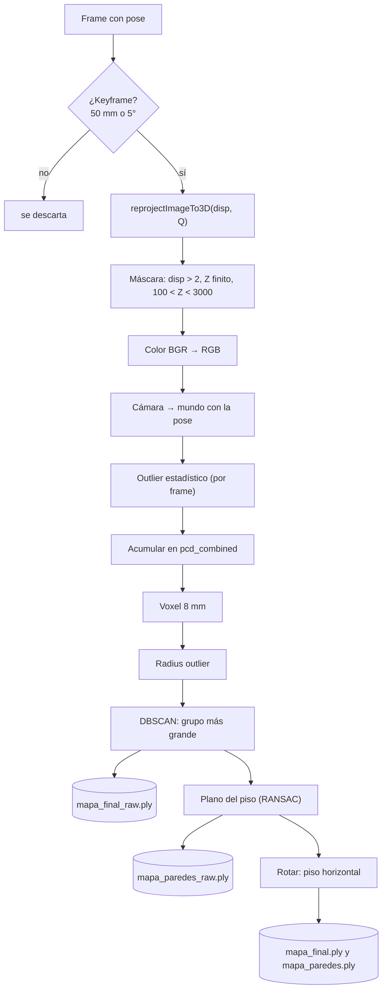

# Nube de puntos: de disparidades a `.ply`

> [!info] Nivel 1 → 3 · Requisitos: [[Camara estereo y disparidad]], [[Pose y matrices 4x4]] · Resumen en [[03 Flujo de datos]]

El proyecto arma dos nubes distintas:

| | **Densa** | **Sparse** |
|---|---|---|
| Quién la arma | `build_point_cloud` (`client_2.py`, y `reprocesar.py` sin `--sparse`) | `reprocesar.py` |
| Qué puntos usa | Todos los píxeles con disparidad válida | Solo los puntos ORB |
| Archivos | `mapa_final.ply`, `mapa_paredes.ply` y sus versiones `_raw` | `nube_sparse.ply`, `trayectoria.ply` |
| Para qué | El mapa detallado | Ver rápido la forma del lugar y el camino del carro |

## Nivel 1: la idea

Cada keyframe aporta sus píxeles como puntos 3D, colocados en el mundo con su pose. Muchos frames ven la misma pared, así que hay puntos repetidos y con ruido. Los filtros hacen cuatro cosas: **quitar lo dudoso**, **juntar lo repetido**, **quitar lo que flota solo** y **enderezar el piso**.

## Nivel 2: la nube densa paso a paso

### Parámetros (dentro de `build_point_cloud`)

| Constante | Valor | Para qué |
|---|---|---|
| `DISP_MIN` | 2.0 px | Disparidad mínima confiable |
| `Z_MIN` / `Z_MAX` | 100 / 3000 mm | Rango de profundidad útil |
| `MIN_POSE_MOV` / `MIN_POSE_ROT` | 50 mm / 5° | Criterio de keyframe |
| `STAT_K` / `STAT_STD` | 20 / 2.0 | Outlier estadístico |
| `VOXEL_SIZE` | 8 mm | Tamaño del cubito de fusión |
| `RAD_POINTS` / `RAD_RADIUS` | 8 / 40 mm | Radius outlier |
| DBSCAN | `eps = 60 mm`, `min_points = 20` | Agrupamiento |
| `DBSCAN_MAX` | 2,000,000 | Arriba de esto se salta DBSCAN |
| Plano del piso | 30 mm, 3 puntos, 1000 iteraciones | `segment_plane` |

### Los pasos

1. **Keyframes.** Un frame entra solo si, desde el último aceptado, el carro avanzó ≥ 50 mm o giró ≥ 5°. Los frames que fallaron en la odometría ni siquiera llegan aquí, porque `_fallo()` los quita de `all_poses`.
2. **Píxeles → 3D.** `cv2.reprojectImageTo3D(disp, Q)` da un arreglo de 720×1280×3 en mm, en coordenadas de la cámara ([[Camara estereo y disparidad]]).
3. **Máscara de 4 filtros.** Cada 10 frames se imprime cuántos píxeles quita cada filtro. Sirve para saber si el problema es "poca disparidad" (lejos o sin textura) o "demasiado cerca".
4. **Color.** `img[mask][:, ::-1] / 255.0`: el `[:, ::-1]` voltea BGR a RGB y la división lo deja entre 0 y 1, como lo pide Open3D.
5. **Cámara → mundo.** Se agrega un 1 a cada punto y se multiplica por la pose: $p_{mundo} = T\,p_{cam}$ ([[Pose y matrices 4x4]]).
6. **Outlier estadístico por frame.** Quita el ruido local antes de mezclar frames.
7. **Acumular** en `pcd_combined`.
8. **Voxel downsample** una sola vez, sobre todo lo acumulado.
9. **Radius outlier:** quita puntos que quedaron solos.
10. **DBSCAN:** se queda con el grupo más grande (el cuarto) y tira el ruido y los grupos pequeños.
11. **Guardar `mapa_final_raw.ply`**, antes de alinear.
12. **Plano del piso** con `segment_plane` y rotación para que su normal quede en el eje Y.
13. **Paredes:** `mapa_paredes.ply` es todo menos los inliers del piso.

### Archivos de salida

| Archivo | Contenido |
|---|---|
| `poses.txt` | Una línea por frame: X, Y, Z en mm y rotación (Rodrigues en grados) |
| `mapa_final_raw.ply` | Nube filtrada, en el sistema de la cámara del frame 0 |
| `mapa_paredes_raw.ply` | Lo mismo sin el piso |
| `mapa_final.ply` | Nube filtrada con el piso horizontal |
| `mapa_paredes.ply` | Sin el piso, con el piso horizontal |
| `nube_sparse.ply` | Puntos ORB (solo `reprocesar.py`) |
| `trayectoria.ply` | Un punto rojo por frame: el centro de la cámara (solo `reprocesar.py`) |

Para verlos: `python ver_nube.py` abre `mapa_final.ply` de la última sesión; `python ver_nube.py <sesion>/nube_sparse.ply <sesion>/trayectoria.ply` abre varios juntos. Los ejes que dibuja miden 100 mm: rojo = X, verde = Y, azul = Z.

## Nivel 3: cómo funciona cada filtro

### Outlier estadístico

Para cada punto $i$ se calcula la distancia promedio a sus $k = 20$ vecinos más cercanos, $\bar d_i$. Con el promedio $\mu$ y la desviación $\sigma$ de todos los $\bar d_i$ del frame, se borra el punto si

$$
\bar d_i > \mu + 2\sigma
$$

> [!example] Ejemplo
> En un frame, $\mu = 5$ mm y $\sigma = 2$ mm, así que el umbral es 9 mm. Un punto en la pared con $\bar d = 4$ mm se queda; un punto "flotando" entre un objeto y el fondo, con $\bar d = 15$ mm, se borra.

### Voxel downsample

Cada punto cae en el cubito con llave

$$
\big(\lfloor x/8 \rfloor,\ \lfloor y/8 \rfloor,\ \lfloor z/8 \rfloor\big)
$$

y de cada cubito queda **un solo punto**: el promedio de posiciones y de colores.

> [!example] Ejemplo
> | Punto (mm) | Llave |
> |---|---|
> | (3, 5, 1) | (0, 0, 0) |
> | (6, 2, 7) | (0, 0, 0) |
> | (9, 1, 1) | (1, 0, 0) |
>
> Los dos primeros se vuelven uno solo en (4.5, 3.5, 4); el tercero queda igual.

Esto une los puntos repetidos de frames distintos y, de paso, promedia su ruido.

### Radius outlier

Se borra un punto si tiene menos de 8 vecinos en 40 mm. Después del voxel de 8 mm, una superficie plana tiene unos $\pi \cdot 40^2 / 8^2 \approx 78$ puntos dentro de ese radio, así que pedir 8 solo quita puntos que de verdad están solos (o bordes muy delgados).

### DBSCAN

- Un punto es **núcleo** si tiene al menos 20 vecinos a menos de 60 mm.
- Un **grupo** son núcleos conectados entre sí (cada uno a menos de 60 mm del siguiente) más sus vecinos.
- Lo que no alcanza ningún grupo es **ruido** (etiqueta −1).

El código se queda con el grupo con más puntos e imprime cuántos quitó y el tamaño de los 5 grupos mayores.

> [!warning] Por qué existe `DBSCAN_MAX`
> Open3D guarda cada punto en `float64`: 24 bytes de posición + 24 de color = 48 bytes, así que 2 millones de puntos son ≈ 96 MB. El problema es DBSCAN, que además guarda los vecinos de cada punto: crece con (puntos × vecinos) y con nubes grandes se acabó la memoria y se cayó el proceso. Arriba de 2 millones de puntos, el paso se salta.

### Alinear el piso

`segment_plane` hace RANSAC sobre la nube final (3 puntos, umbral de 30 mm, 1000 intentos) y devuelve el plano con más puntos. Su normal se voltea si hace falta para que $n_y > 0$, y se rota la nube con la fórmula de Rodrigues para llevarla al eje $(0, 1, 0)$. La derivación está en [[03 Flujo de datos]]. Las dos nubes se rotan alrededor del mismo centro (el de `pcd_final`), así que quedan alineadas entre sí.

## La nube sparse (`reprocesar.py`)

1. **Filtro de borrosas:** nitidez = varianza del Laplaciano de la imagen en gris. Se descartan los frames con nitidez menor a `--blur` (0.6 por defecto) × la mediana de la sesión. El umbral es relativo porque la nitidez cambia mucho con la luz.
2. **Odometría** con los frames nítidos.
3. Para cada frame con pose, `vo.get_frame_points(idx)` da los puntos ORB en 2D y 3D. Se quedan los que cumplen:
    - $100 < Z <$ `--zmax` (3000 mm por defecto);
    - **no están en un borde de profundidad**: el rango de disparidad en una ventana de 5×5 (`dilate − erode`) es menor a 2 px.
4. **Keyframes con las poses finales** (después del PGO, si lo hubo): 50 mm o 5°. Sin esto, con el carro quieto el mismo punto se agregaba cientos de veces y aparecían "rayos" saliendo de la cámara. `--todos-los-frames` lo apaga para comparar.
5. **Al mundo:** `pts @ T[:3, :3].T + T[:3, 3]`. Es lo mismo que $R\,p + t$ para cada fila, porque $(R\,p)^\top = p^\top R^\top$.
6. **Trayectoria:** el centro de cada cámara, en rojo.
7. Imprime el **recorrido** (suma de los pasos) y el **desplazamiento neto** (del primer al último centro). En un recorrido que regresa al inicio, el desplazamiento neto debería ser casi 0: es una forma rápida de medir el drift.

## Hallazgos

1. **La alineación no verifica que el plano sea el piso.** `segment_plane` devuelve el plano más grande, y en un pasillo puede ser una pared; entonces el mapa queda con la pared "acostada". La odometría sí lo revisa ($n_y \ge 0.7$, ver [[Movimiento plano]]). Propuesta simple: si `vo.floor_info` existe, usar `vo.A[1]` como normal del piso. Con el movimiento plano todas las cámaras tienen la misma inclinación, así que esa normal vale también en el sistema del mundo (el de la cámara del frame 0).
2. **El eje Y apunta hacia abajo.** Es la convención de la cámara ([[Pose y matrices 4x4]]) y la alineación la conserva (la normal del piso va a $+Y$). Si un visor muestra el mapa de cabeza, es por eso.
3. **`mapa_paredes` también pierde lo que está pegado al piso:** todo lo que queda a menos de 30 mm del plano (cables, un control, la base de un mueble).
4. **Código muerto:** `ICP_MIN_FIT`, `skipped_icp` y `prev_pcd` ya no se usan, `FRAME_STRIDE = 1` no hace nada, y quedan bloques de DBSCAN comentados. `pcd_raw_for_export` es solo una copia de `pcd_final`.
