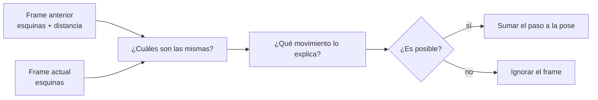

# VO 1: Intuición

> [!info] Nivel 1 · Serie VO: **1** · [[VO 2 En el proyecto]] · [[VO 3 Profundidad de los puntos]] · [[VO 4 PnP RANSAC]] · [[VO 5 Movimiento plano]] · [[VO 6 Pose acumulada y fallos]]

## ¿Qué es la odometría?

**Odometría** es medir cuánto te moviste. La de un coche cuenta vueltas de las llantas. La **visual** lo hace **comparando dos fotos seguidas**: si el cuadro de la pared estaba a 2 m y ahora está a 1.9 m, avanzaste unos 10 cm.

El carrito no tiene sensores en las ruedas, así que **toda** la información de dónde está sale de la cámara.

## Las cinco preguntas de cada frame

| # | Pregunta | Quién la responde | Nota |
|---|---|---|---|
| 1 | ¿Qué puntos puedo reconocer? | ORB: unas 1000 esquinas con su huella | [[ORB 1 Intuicion]] |
| 2 | ¿Cuáles son los mismos que en el frame anterior? | Matching con el ratio de Lowe | [[ORB 6 Hamming y matching]] |
| 3 | ¿A qué distancia estaban? | La disparidad de RAFT | [[VO 3 Profundidad de los puntos]] |
| 4 | ¿Qué movimiento explica cómo cambiaron de lugar? | PnP RANSAC | [[VO 4 PnP RANSAC]] |
| 5 | ¿Ese movimiento es posible para un carro? | Detector de saltos y movimiento plano | [[VO 5 Movimiento plano]], [[VO 6 Pose acumulada y fallos]] |

## Una analogía

Caminas por un cuarto a oscuras con una linterna que solo prendes un instante en cada paso. En cada destello te fijas en tres o cuatro cosas fáciles de reconocer (la esquina de una mesa, el apagador) y en qué tan lejos están. En el siguiente destello las buscas otra vez: si la mesa quedó más cerca y un poco a la izquierda, sabes que avanzaste y giraste un poco a la derecha.

Si en un destello confundes el apagador con otro igual, tu cálculo sale mal. Por eso no te basta con una sola cosa: buscas el movimiento con el que **la mayoría** de las cosas están de acuerdo. Eso es RANSAC.

## ¿Por qué hace falta el estéreo?

Con una sola cámara, una casa de muñecas y un cuarto de verdad se ven igual: puedes calcular **hacia dónde** te moviste, pero no **cuánto** (si 1 cm o 1 m). Con dos lentes, cada esquina trae su distancia en milímetros reales, y el movimiento sale también en milímetros reales.

## El enemigo: el *drift*

Cada paso tiene un error pequeño, y la odometría **suma** los pasos, así que los errores se acumulan. Si en cada frame te equivocas 1 mm hacia arriba, después de 500 frames el carro "cree" que flota a medio metro del piso. El proyecto pelea contra eso de dos formas:

- **Movimiento plano:** prohíbe los movimientos imposibles para un carro (subir, cabecear, alabear) en cada paso. Ver [[VO 5 Movimiento plano]].
- **Loop closure:** reconocer un lugar ya visitado y corregir todo el camino. Está apagado por ahora; ver [[LC 1 Intuicion]].

## ¿Qué sale de aquí?

Una **pose** (posición + orientación, una matriz 4×4) por cada frame que salió bien. Con ellas:

- se escribe `poses.txt`, el camino del carro;
- cada frame coloca sus puntos 3D en el lugar correcto del mapa ([[Nube 1 Intuicion]]).
