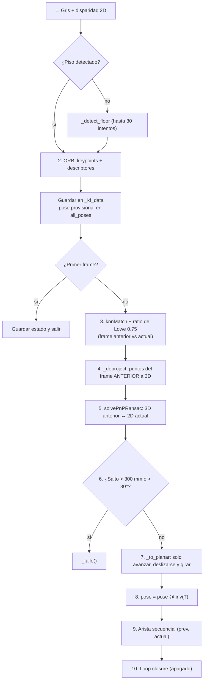

# VO 2: La odometría en el proyecto

> [!info] Nivel 2 · Serie VO: [[VO 1 Intuicion]] · **2** · [[VO 3 Profundidad de los puntos]] · [[VO 4 PnP RANSAC]] · [[VO 5 Movimiento plano]] · [[VO 6 Pose acumulada y fallos]]

Todo vive en la clase `VisualOdometry` de `visual_odometry.py`.

## Quién la usa

| Dónde | Cómo |
|---|---|
| `client_2.py` → `slam_offline` | El hilo `vo_worker_off` recibe `(frame_idx, izq, disp)` de la cola de RAFT y llama a `vo.update(...)` |
| `reprocesar.py` | Lee las `.npy` ya guardadas y llama a `vo.update(...)` frame por frame, sin RAFT |

```python
vo = VisualOdometry(Q, K_rect, inclinacion_deg=None)
resultado = vo.update(izq, disp, frame_idx=idx)   # (R, t) o None si el frame fallo
poses = vo.get_all_poses()                        # {frame_idx: 4x4}
uv, pts3d = vo.get_frame_points(idx)              # puntos ORB del frame (nube sparse)
```

| Parámetro del constructor | Qué es |
|---|---|
| `Q` | Matriz de reproyección de `stereoRectify` ([[Camara estereo y disparidad]]) |
| `K` | `K_rect = P1[:3, :3]`, la K de la imagen rectificada |
| `inclinacion_deg` | Ángulo de la cámara respecto al piso; `None` = detectar el piso ([[VO 5 Movimiento plano]]) |

## El mapa de `update(frame, disp, frame_idx)`



| Paso | Qué hace | Nota |
|---|---|---|
| 1 | Pasa la imagen a gris y deja la disparidad como arreglo 2D (`_ensure_2d`) | [[VO 3 Profundidad de los puntos]] |
| 2 | Unas 1000 esquinas con su huella de 256 bits | [[ORB 2 En el proyecto]] |
| 3 | Empareja las huellas del frame anterior con las del actual | [[ORB 6 Hamming y matching]] |
| 4 | Convierte los puntos del frame anterior a 3D con **su** disparidad | [[VO 3 Profundidad de los puntos]] |
| 5 | Rotación y traslación que mejor explican cómo se movieron esos puntos | [[VO 4 PnP RANSAC]] |
| 6 | Un carrito no avanza 30 cm en 1/30 de segundo: si lo hace, es un error | [[VO 6 Pose acumulada y fallos]] |
| 7 | Quita subir/bajar, cabeceo y alabeo | [[VO 5 Movimiento plano]] |
| 8 | Acumula la pose | [[VO 6 Pose acumulada y fallos]] |
| 9 | Guarda la medición para el grafo de poses | [[LC 5 Grafo de poses]] |
| 10 | Si reconoce un lugar viejo, optimiza todas las poses | [[LC 2 En el proyecto]] |

## El estado que guarda la clase

| Atributo | Qué guarda |
|---|---|
| `prev_kp`, `prev_des`, `prev_disp`, `prev_frame` | El frame de **referencia**: el último frame bueno (o el del último reinicio) |
| `pose` | Pose acumulada, cámara → mundo (4×4). El mundo es la cámara del primer frame |
| `all_poses` | `{frame_idx: 4x4}` de los frames con pose válida |
| `seq_edges`, `loop_edges` | Aristas del grafo de poses |
| `_kf_data` | `{frame_idx: {'des', 'pts3d', 'uv'}}`: unos 50 KB por frame (antes se guardaba la disparidad completa: 3.7 MB) |
| `_fallos` | Frames fallidos seguidos desde el último bueno |
| `A`, `floor_info` | Sistema del piso para el movimiento plano |

## Parámetros

| Constante | Valor | Qué controla |
|---|---|---|
| `LOWE_RATIO` | 0.75 | Qué tan estricto es el matching |
| `MIN_PNP_MATCHES` / `MIN_PNP_INLIERS` | 12 / 12 | Mínimos para confiar en PnP |
| `PNP_ITERATIONS` | 200 | Intentos máximos de RANSAC |
| `PNP_REPROJ_ERR` | 2.0 px | Tolerancia para ser inlier (pensada para 640×360) |
| `JUMP_MAX_TRANS` / `JUMP_MAX_ROT` | 300 mm / 30° | Detector de saltos |
| `MAX_FALLOS` | 5 | Fallos seguidos antes de reiniciar la referencia |
| `USE_PLANAR` | `True` | Restricción de movimiento plano |
| `USE_ICP` | `False` | ICP apagado (ver [[VO 6 Pose acumulada y fallos]]) |
| `USE_LOOP_CLOSURE` | `False` | Loop closure apagado (ver [[LC 2 En el proyecto]]) |

`reprocesar.py` cambia algunos al arrancar: `--icp`, `--loops` y `--sin-plano`.

## Guía de depuración: mensajes de la consola

| Mensaje | Causa probable | Qué revisar |
|---|---|---|
| `failed des < 8` | Casi no hay esquinas: imagen borrosa, oscura o pared lisa | Luz, velocidad del carro, `fastThreshold` |
| `failed matches < MIN_PNP_MATCHES` | Menos de 12 parejas pasaron el ratio de Lowe | Movimiento muy brusco o textura repetitiva |
| `failed valid.sum() < MIN_PNP_INLIERS` | Las parejas no tienen disparidad válida (≥ 2 px) | Puntos muy lejanos o RAFT falló |
| `failed not success or no inliers` | PnP no encontró 12 inliers consistentes | Muchas parejas falsas ([[VO 4 PnP RANSAC]]) |
| `[VO] SALTO frame N` | PnP dio un movimiento imposible | Cuenta como fallo, igual que los demás |
| `[VO] 5 fallos seguidos: nueva referencia` | El último frame bueno quedó muy lejos | Ese hueco sí se pierde; si sale seguido, revisa luz y velocidad |
| `[VO] Movimiento plano (...)` | Se definió el piso | Que la inclinación tenga sentido |
| `[SLAM] Cobertura: X %` | Frames con pose / frames totales | Arriba de 60 % se considera buena |

## Tiempos

Con ICP apagado la odometría tarda unos **45 ms por frame** (con ICP eran 220 ms). `reprocesar.py` imprime `[TIEMPO] VO (...)` con el total y el promedio por frame.
