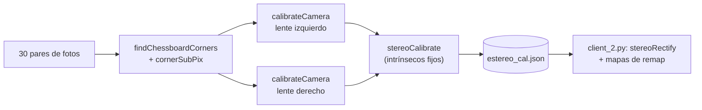

# Calibración estéreo a fondo

> [!info] Nivel 2 → 3 · Requisito: [[Calibracion y rectificacion]] (el resumen) · Archivo: `camera_calibration_dualCamera.py`

## La herramienta

| Modo | Qué hace |
|---|---|
| `captura` | Muestra la cámara en vivo, marca si cada lente ve el tablero y guarda el par con ESPACIO (solo si **ambos** lo ven) |
| `calibrar` | Calibra cada lente, luego la relación entre ellos, y escribe el JSON |
| `imagenes` | Igual que `calibrar` |
| `rectificar` | Aplica la calibración a un par de fotos y dibuja líneas horizontales cada 40 px para revisar |

```bash
python camera_calibration_dualCamera.py captura    --cam 0 --carpeta Calibracion_Camara/fotos_estereo
python camera_calibration_dualCamera.py calibrar   --carpeta Calibracion_Camara/fotos_estereo --sal Calibracion_Camara/estereo_cal.json
python camera_calibration_dualCamera.py rectificar --izq IZQ.jpg --der DER.jpg --cal Calibracion_Camara/estereo_cal.json
```

> [!warning] Dos trampas de la herramienta
> - El docstring dice `calibracion_estereo.py`, pero el archivo se llama `camera_calibration_dualCamera.py`.
> - Por defecto escribe `estereo_cal.json` en la carpeta desde donde lo corres, pero `client_2.py` lo lee de `Calibracion_Camara/estereo_cal.json` (o de la variable de entorno `CAL_JSON`). Usa `--sal`.



## Paso 1: el tablero

```python
COLS_ESQUINAS  = 10     # esquinas internas por fila
FILAS_ESQUINAS = 7      # esquinas internas por columna
TAMANO_CUADRO  = 20.0   # mm, medido con regla
```

`preparar_objp` crea las 70 esquinas en 3D, sobre el plano $Z = 0$ y en mm: $(0,0,0), (20,0,0), \dots, (180,0,0), (0,20,0), \dots, (180,120,0)$. **Toda la escala del proyecto sale de aquí:** si los cuadros midieran 21 mm y no 20, todas las distancias del mapa saldrían 5 % cortas.

## Paso 2: encontrar las esquinas

1. `findChessboardCorners` con umbral adaptativo y normalización de la imagen: encuentra las 70 esquinas con precisión de un píxel.
2. `cornerSubPix` con `winSize = (11, 11)` (una ventana de 23×23 px) y criterio de 30 iteraciones o 0.001 px: las refina a **subpíxel**.

> [!note] Cómo funciona `cornerSubPix` (nivel 3)
> Si $\mathbf{p}$ es la esquina exacta, para cualquier punto $\mathbf{q}$ cercano pasa una de dos cosas: o está en una zona plana (gradiente 0) o está sobre un borde que pasa por $\mathbf{p}$ (gradiente perpendicular a $\mathbf{q} - \mathbf{p}$). En los dos casos
> $$\nabla I(\mathbf{q}) \cdot (\mathbf{q} - \mathbf{p}) = 0$$
> Con todos los puntos de la ventana se resuelve por mínimos cuadrados:
> $$\mathbf{p} = \Big(\sum_{\mathbf{q}} \nabla I\,\nabla I^\top\Big)^{-1} \sum_{\mathbf{q}} \nabla I\,\nabla I^\top\,\mathbf{q}$$
> y se repite centrando la ventana en el nuevo $\mathbf{p}$.

Solo se usan los pares donde **los dos** lentes encontraron el tablero.

## Paso 3: cada lente por separado (`calibrateCamera`)

Es el método de Zhang: busca la K, la distorsión y la pose del tablero en cada foto que mejor explican las esquinas observadas.

| | Cantidad |
|---|---|
| Incógnitas | 4 (K) + 5 (distorsión) + 6 × 30 (pose del tablero en cada foto) = **189** |
| Datos | 30 fotos × 70 esquinas × 2 coordenadas = **4200** |

Minimiza el error de reproyección: la distancia entre donde se vio cada esquina y donde la proyecta el modelo. Devuelve el **RMS** de esos errores:

$$
\text{RMS} = \sqrt{\frac{1}{N}\sum_{i=1}^{N} \lVert \mathbf{u}_i - \hat{\mathbf{u}}_i \rVert^2}
$$

Resultado: **0.38 px** (izquierdo) y **0.39 px** (derecho). Menos de 0.5 px es bueno.

### El modelo de distorsión

Con $(x, y)$ = coordenadas normalizadas ideales ($X/Z$, $Y/Z$) y $r^2 = x^2 + y^2$:

$$
\begin{aligned}
x_d &= x\,(1 + k_1 r^2 + k_2 r^4 + k_3 r^6) + 2p_1 xy + p_2(r^2 + 2x^2) \\
y_d &= y\,(1 + k_1 r^2 + k_2 r^4 + k_3 r^6) + p_1(r^2 + 2y^2) + 2p_2 xy \\
u &= f_x x_d + c_x, \qquad v = f_y y_d + c_y
\end{aligned}
$$

Lente izquierdo: $k_1 = -0.409$, $k_2 = 0.209$, $k_3 = -0.066$; $p_1, p_2 \approx 0.001$ (casi nada de distorsión tangencial). Un $k_1$ negativo es distorsión **de barril**: los puntos se "encogen" hacia el centro, más mientras más lejos estén.

> [!example] Cuánto encoge (lente izquierdo, solo la parte radial)
> | Radio ideal $r$ | Radio dibujado $r_d$ | Factor | En píxeles ($f \approx 871$) |
> |---|---|---|---|
> | 0.2 | 0.197 | 0.98 | 174 → 172 px |
> | 0.5 | 0.455 | 0.91 | 436 → 396 px |
> | 0.8 | 0.645 | 0.81 | 697 → 562 px |
> | 1.0 | 0.734 | 0.73 | 871 → 639 px |
> | 1.2 | 0.778 | 0.65 | 1046 → 678 px |
> | 1.4 | 0.710 | 0.51 | 1220 → 618 px |

### Hallazgo: el modelo "se dobla" en las esquinas de la imagen

En la tabla de arriba, $r_d$ **crece hasta $r \approx 1.2$ y luego baja**. El máximo es $r_d \approx 0.78$. Pero la esquina de la imagen, el píxel (0, 0), está en

$$
x_d = \frac{0 - 646.6}{871.4} = -0.742, \quad y_d = \frac{0 - 351.4}{870.6} = -0.404, \quad r_d = 0.845 > 0.78
$$

Ningún punto ideal produce ese radio: **para las cuatro esquinas de la imagen el modelo no tiene solución** ($r_d$ entre 0.83 y 0.85). Los bordes laterales a media altura ($r_d \approx 0.74$) sí la tienen.

**Consecuencias** (calculadas con OpenCV 5.0 a partir de `estereo_cal.json`; conviene confirmarlas en tu entorno):

- `undistortPoints` da valores sin sentido en las esquinas: (−1.82, −0.99) para la esquina superior izquierda contra (1.25, −0.70) para la superior derecha, que deberían ser casi simétricas.
- `stereoRectify` usa esas esquinas para calcular la imagen rectificada y el centro óptico queda muy desplazado: $c_x \approx 857$, $c_y \approx 303$, cuando el centro de la imagen es (640, 360).
- Se nota en las fotos. En el frame 100 de `session_20261018_114813`, la imagen original del lente izquierdo muestra a la derecha la puerta del clóset con espejo; la imagen rectificada termina antes, en la chamarra negra. **Se pierde una franja del lado derecho del campo de visión.**

**Causa probable:** pocas fotos con el tablero en las esquinas. Sin datos ahí, el polinomio de grado 6 extrapola mal.

**Cómo revisarlo:**

```python
import json
import numpy as np

cal = json.load(open('Calibracion_Camara/estereo_cal.json'))
k1, k2, p1, p2, k3 = np.array(cal['lente_izquierdo']['coef_distorsion']).ravel()
r = np.linspace(0, 1.5, 16)                        # radio ideal
r_d = r * (1 + k1 * r**2 + k2 * r**4 + k3 * r**6)  # radio con distorsion
print(np.round(r_d, 3))   # debe crecer siempre hasta el radio de las esquinas (~0.85)
```

**Cómo corregirlo:** recalibrar con fotos del tablero en las esquinas y los bordes de la imagen. Si aun así se dobla, probar `calibrateCamera` con `flags=cv.CALIB_FIX_K3` (un término menos, extrapola con más calma) o con `cv.CALIB_RATIONAL_MODEL` (un modelo pensado para lentes con mucha distorsión). Después de recalibrar, revisar que $c_x, c_y$ de `P1` queden cerca del centro.

## Paso 4: la relación entre los lentes (`stereoCalibrate`)

Con `flags = cv.CALIB_FIX_INTRINSIC`, las K y las distorsiones del paso 3 quedan fijas y solo se busca cómo está colocado el lente derecho respecto al izquierdo:

$$
X_{der} = R\,X_{izq} + T
$$

| Resultado | Valor | Lectura |
|---|---|---|
| $T$ | (−59.40, −0.03, −0.96) mm | El lente derecho está 59.4 mm a la derecha del izquierdo (visto desde el derecho, el origen del izquierdo queda en $x = -59.4$) y ≈ 1 mm más atrás o adelante |
| $\lVert T \rVert$ | **59.40 mm** | El *baseline* |
| $R$ (ángulos) | 0.40° sobre X, −0.03° sobre Y, −0.09° sobre Z | Casi paralelos. El código llama *roll* al giro sobre X |
| `rms_estereo` | 0.48 px | Error de los dos lentes juntos |

> [!example] ¿Importan 0.4°?
> Un lente apunta 0.4° más arriba que el otro. En píxeles: $\tan(0.4°) \cdot 871 \approx 6$ px. Sin rectificar, el gemelo de cada punto estaría unas **6 filas** más arriba o más abajo, y la búsqueda "en la misma fila" de RAFT fallaría. Por eso la rectificación es indispensable aunque los lentes parezcan alineados.

También se guardan:

- **Matriz esencial** $E = [T]_\times R$. Para dos puntos gemelos en coordenadas normalizadas: $\mathbf{x}_{der}^\top E\,\mathbf{x}_{izq} = 0$ (la restricción epipolar).
- **Matriz fundamental** $F = K_{der}^{-\top} E\,K_{izq}^{-1}$: la misma restricción, en píxeles.

## Paso 5: rectificar (`stereoRectify`, en `client_2.py`)

`alpha` decide cuánto "zoom" se hace:

| `alpha` | Qué hace | $f$ resultante |
|---|---|---|
| −1 (por defecto de OpenCV) | Escala automática | ≈ 870 |
| **0 (el del proyecto)** | Recorta para que no queden píxeles negros | **≈ 919** |
| 1 | Conserva todos los píxeles originales | ≈ 313 (las esquinas sin solución se van muy lejos) |

Valores que salen con `alpha = 0`:

$$
P_1 = \begin{bmatrix} 918.9 & 0 & 857.4 & 0 \\ 0 & 918.9 & 303.3 & 0 \\ 0 & 0 & 1 & 0 \end{bmatrix},
\qquad
Q = \begin{bmatrix} 1 & 0 & 0 & -857.4 \\ 0 & 1 & 0 & -303.3 \\ 0 & 0 & 0 & 918.9 \\ 0 & 0 & 1/59.4 & 0 \end{bmatrix}
$$

> [!important] La $f$ que vale para $Z = fB/d$ es la de la imagen rectificada
> Con estos valores, $fB \approx 918.9 \times 59.4 \approx 54{,}584$ px·mm, un 5.5 % más que con la $f$ de K (≈ 871) que usan las tablas de [[Camara estereo y disparidad]]. Para ver la Q real de tu entorno: `build_point_cloud` la imprime al procesar el primer frame (`[PC] Q:`).

## Hallazgo: `error_reproyeccion` está mal calculado

`calibrar_mono` guarda un segundo error además del RMS:

```python
error_total += cv.norm(imgpoints[i], pts2, cv.NORM_L2) / len(pts2)
```

`NORM_L2` es la raíz de la **suma** de los errores al cuadrado, y dividir entre $n = 70$ da $\text{RMS}_i / \sqrt{70}$, no el RMS. Por eso el JSON dice 0.045 px cuando el error real es ≈ 0.38 px ($0.38 / \sqrt{70} \approx 0.046$). Corrección:

```python
dif = imgpoints[i] - pts2                          # (70, 1, 2)
err_i = np.sqrt(np.mean(np.sum(dif ** 2, axis=2)))  # RMS de la imagen i, en pixeles
```

## Otros detalles de la herramienta

1. **`captura` no fuerza MJPG.** `server_2.py` lo pone antes de la resolución porque así se logra 2560×720 a 30 FPS. La calibración actual sí salió a 1280×720 por lente, pero si una cámara no entrega esa resolución, falta ese ajuste.
2. **`FPS = 60` en la calibración y 30 en el servidor.** No afecta a la calibración (son fotos fijas), solo a la vista en vivo.
3. **El resumen estéreo supone $f \approx 600$** (`fx_aprox = 600`) para imprimir el rango de disparidades; con la $f$ real (≈ 871) los números impresos salen unos 30 % bajos.

## Checklist para recalibrar

1. Tablero **plano** (pegado a algo rígido) y cuadros medidos con regla; actualizar `TAMANO_CUADRO` si no miden 20 mm.
2. Misma resolución que se usa al grabar: 1280×720 por lente.
3. 20 a 30 pares que cubran **centro, bordes y esquinas**, a distintas distancias y con el tablero inclinado en varias direcciones.
4. RMS de cada lente < 0.5 px y `rms_estereo` < 0.5 px.
5. Polinomio de distorsión creciente hasta el radio de las esquinas (script de arriba).
6. $c_x, c_y$ de `P1` cerca de (640, 360).
7. `rectificar` sobre un par nuevo: un mismo punto debe quedar en la misma línea verde en las dos imágenes.
8. Guardar en `Calibracion_Camara/estereo_cal.json` (o apuntar `CAL_JSON` al archivo nuevo).
