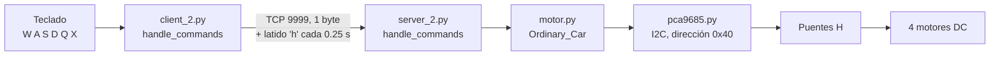
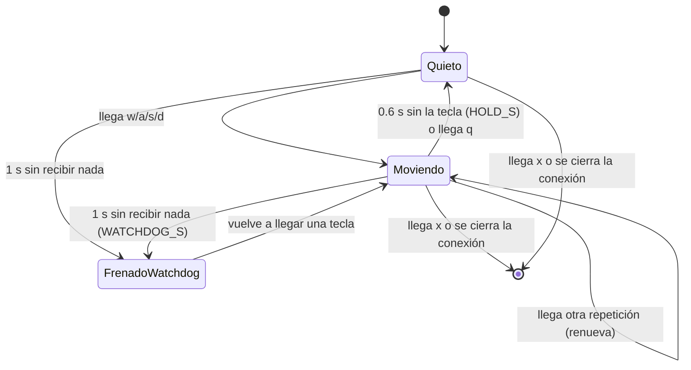

# Control del carrito: del teclado a las ruedas

> [!info] Nivel 1 → 3 · Requisitos: [[02 Arquitectura general]] · Archivos: `client_2.py` (`handle_commands`), `server_2.py`, `motor.py`, `pca9685.py`

## Nivel 1: la cadena completa



- La **PC** solo manda letras.
- La **Pi** traduce cada letra a cuatro velocidades, una por rueda.
- El **PCA9685** es un chip que genera 16 señales PWM; la Pi le habla por I2C.
- Los **puentes H** convierten esas señales en corriente para los motores, en un sentido o en el otro.

**PWM** (modulación por ancho de pulso): en lugar de bajar el voltaje, se prende y apaga el motor muy rápido. Si está prendido el 25 % del tiempo, el motor recibe en promedio un cuarto de la potencia.

## Nivel 2: en el código

### Del lado de la PC (`client_2.py`)

| Elemento | Qué hace |
|---|---|
| `handle_commands` | Lee el teclado sin esperar Enter y manda cada tecla válida (`w a s d q x`) |
| Latido | Cada `HEARTBEAT_S = 0.25 s` manda `'h'`, aunque no se presione nada |
| Windows | `msvcrt.kbhit()` / `getch()`. Las teclas especiales (flechas, F1…) llegan con un prefijo `\x00` o `\xe0` y se ignoran |
| Linux | `tty.setraw` + `select` con espera de 0.1 s |
| `request_shutdown` | Manda `'q'` (frenar) y `'x'` (terminar). Se llama con X en la terminal, con X en la ventana de vista previa o si algo falla |

### Del lado de la Pi (`server_2.py`)

```python
SPEED_FWD  = 600    # avanzar / retroceder
SPEED_TURN = 900    # girar sobre su eje (antes 1500)
COMMANDS = {
    'w': ( SPEED_FWD,   SPEED_FWD,   SPEED_FWD,   SPEED_FWD),
    's': (-SPEED_FWD,  -SPEED_FWD,  -SPEED_FWD,  -SPEED_FWD),
    'a': (-SPEED_TURN, -SPEED_TURN,  SPEED_TURN,  SPEED_TURN),
    'd': ( SPEED_TURN,  SPEED_TURN, -SPEED_TURN, -SPEED_TURN),
    'q': (0, 0, 0, 0),
    'x': (0, 0, 0, 0),
}
```

El orden de los 4 números es: izquierda-adelante, izquierda-atrás, derecha-adelante, derecha-atrás.

| Tecla | Ruedas izquierdas | Ruedas derechas | Resultado |
|---|---|---|---|
| W | +600 (14.6 %) | +600 | Avanza |
| S | −600 | −600 | Retrocede |
| A | −900 (22.0 %) | +900 | Gira a la izquierda sobre su eje |
| D | +900 | −900 | Gira a la derecha sobre su eje |
| Q / X | 0 | 0 | Freno |

El carro gira como un tanque (*skid steering*): no tiene dirección, así que las ruedas de un lado van hacia adelante y las del otro hacia atrás.

### Mantener presionado y watchdog (`handle_commands` en la Pi)



- `conn.settimeout(0.05)`: el ciclo revisa los tiempos al menos cada 50 ms, aunque no llegue nada.
- `last_rx` se actualiza con **cualquier** byte, incluido el latido `'h'`. `last_move` solo con `w a s d`.
- `apply(cmd)` solo escribe al PCA9685 si el comando **cambia**. Con la tecla presionada llegan unas 30 repeticiones por segundo; sin esta condición serían 30 escrituras por segundo de 32 registros cada una (ver nivel 3).

> [!example] Línea de tiempo: avanzar y soltar
> | Tiempo | Qué pasa |
> |---|---|
> | 0.00 s | Presionas W: llega `'w'`, los motores arrancan |
> | 0.00 – ~0.50 s | El teclado espera antes de empezar a repetir (típicamente unos 0.5 s). `HOLD_S = 0.6 s` cubre ese hueco, por eso el carro no da tirones |
> | ~0.50 – 3.00 s | Llegan repeticiones; cada una renueva `last_move` |
> | 3.00 s | Sueltas W |
> | ≈ 3.60 – 3.65 s | Pasaron 0.6 s sin `'w'`: el carro frena |
>
> Si a las 5.00 s se cae el wifi con el carro avanzando, el último byte llegó a lo mucho a las 5.00 s y el watchdog frena a más tardar a las **≈ 6.05 s** (1 s + un ciclo de 50 ms).

### Fin de la sesión

`'x'` frena y rompe el ciclo de comandos. En el `finally` se activa `stop_event`, eso detiene el hilo de video, y `main()` cierra los sockets. El servidor atiende **una sola sesión**: para grabar otra hay que volver a correr `server_2.py`.

### Rueda por rueda (`motor.py`)

Cada rueda usa **dos canales** del PCA9685, uno por cada entrada de su puente H:

| Rueda | Método | Adelante (canal con PWM) | Atrás (canal con PWM) |
|---|---|---|---|
| Izquierda adelante | `left_upper_wheel` | 1 | 0 |
| Izquierda atrás | `left_lower_wheel` | 2 | 3 |
| Derecha adelante | `right_upper_wheel` | 7 | 6 |
| Derecha atrás | `right_lower_wheel` | 5 | 4 |

- `duty > 0`: un canal en 0 y el otro con el PWM → adelante.
- `duty < 0`: al revés → atrás, con `abs(duty)`.
- `duty == 0`: **ambos canales en 4095**. Con las dos entradas del puente H en alto, el motor queda en corto y frena activamente, en vez de solo dejar de empujar.
- `duty_range` recorta cada valor a ±4095.

Para probar el cableado sin la PC: `python motor.py` en la Pi hace avanzar, retroceder, girar a la izquierda y a la derecha 1 s cada uno (con PWM 2000) y frena.

## Nivel 3: el PCA9685 por dentro

### Frecuencia (`set_pwm_freq(50)`)

El chip tiene un reloj interno de 25 MHz y un contador de 12 bits (0 a 4095). El divisor (*prescale*) sale de:

$$
\text{prescale} = \operatorname{round}\!\left(\frac{25\,000\,000}{4096 \cdot f} - 1\right) = \operatorname{round}(121.07) = 121
$$

$$
f_{real} = \frac{25\,000\,000}{4096 \cdot (121 + 1)} \approx 50.03 \text{ Hz} \quad\Rightarrow\quad \text{periodo} \approx 20 \text{ ms}
$$

El prescale solo se puede escribir con el chip dormido: por eso el código pone el bit de *sleep* (`0x10`) en `MODE1`, escribe `PRESCALE` (`0xFE`), restaura el modo y, tras 5 ms, pone el bit de reinicio (`0x80`).

### Ciclo de trabajo

`set_motor_pwm(ch, duty)` llama a `set_pwm(ch, on=0, off=duty)`: la salida se prende en la cuenta 0 y se apaga en la cuenta `duty`.

$$
\text{ciclo de trabajo} = \frac{\text{duty}}{4096}
$$

| Valor | Ciclo | Tiempo encendido por periodo de 20 ms |
|---|---|---|
| 600 (avanzar) | 14.6 % | 2.9 ms |
| 900 (girar) | 22.0 % | 4.4 ms |
| 2000 (prueba de `motor.py`) | 48.8 % | 9.8 ms |
| 4095 (freno, ambos canales) | ≈ 100 % | ≈ 20 ms |

### Registros

Cada canal $n$ tiene 4 registros de 8 bits a partir de `0x06 + 4n`: `ON_L`, `ON_H`, `OFF_L`, `OFF_H`. Un valor de 12 bits se parte en byte bajo (`& 0xFF`) y byte alto (`>> 8`).

> [!example] Ejemplo: canal 7 con duty 600
> - Dirección base: $0x06 + 4 \cdot 7 = 0x22$.
> - `ON` = 0 → `0x22` ← 0, `0x23` ← 0.
> - `OFF` = 600 = `0x258` → `0x24` ← `0x58` (88), `0x25` ← `0x02`.
> - Comprobación: $2 \cdot 256 + 88 = 600$.

Cada `set_pwm` son 4 escrituras I2C, y `set_motor_model` toca 8 canales: **32 escrituras por comando**. Por eso `apply()` solo escribe cuando el comando cambia.

## Observaciones

1. **La terminal debe tener el foco para manejar.** Las teclas W/A/S/D se leen de la terminal. Si el foco está en una ventana de vista previa de OpenCV, esa ventana solo atiende la X.
2. **En Linux, Ctrl+C no funciona mientras manejas.** `tty.setraw` desactiva las señales del teclado; para salir hay que usar X. La terminal se restaura en el `finally`.
3. **El carro sigue moviéndose hasta 0.65 s después de soltar la tecla.** A una velocidad $v$, recorre unos $0.65\,v$ extra. Si se necesita frenar en seco, Q frena de inmediato.
4. **La velocidad de giro afecta al SLAM.** Un giro rápido desplaza mucho la imagen entre frames y la hace borrosa: menos parejas ORB y más frames fallidos. `SPEED_TURN` ya se bajó de 1500 a 900 por eso de manejo; si `reprocesar.py` descarta muchos frames por borrosos en los giros, vale la pena probar un valor menor.
5. **50 Hz es la frecuencia típica de servos.** Para motores DC se suele usar una frecuencia más alta. Si a baja velocidad el arranque es brusco o se oye zumbido, es un experimento posible (sin olvidar que `set_servo_pulse` asume 50 Hz).
6. Detalles menores: `debug=True` en `PCA9685(...)` no se usa, y el servidor frena con `stop_motors()` pero no llama a `Ordinary_Car.close()`, que también cerraría el bus I2C.
