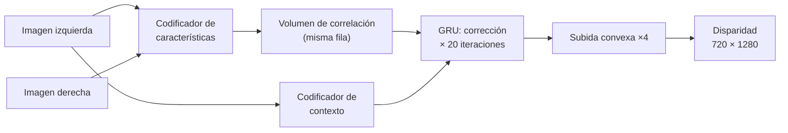

# RAFT 1: Intuición

> [!info] Nivel 1 · Serie RAFT: **1** · [[RAFT 2 En el proyecto]] · [[RAFT 3 Codificadores]] · [[RAFT 4 Correlacion y piramide]] · [[RAFT 5 Actualizacion con GRU]] · [[RAFT 6 Subida convexa]]

## ¿Para qué lo necesitamos?

Para armar el mapa hace falta la distancia de **cada píxel**, no solo de unas cuantas esquinas. La distancia sale de la **disparidad**: cuánto se desplaza un punto entre la imagen izquierda y la derecha ([[Camara estereo y disparidad]]). RAFT-Stereo es la red neuronal que calcula esa disparidad para los 921,600 píxeles de cada imagen.

Gracias a la rectificación, el gemelo de cada píxel está **en la misma fila** de la otra imagen, un poco más a la izquierda. El problema se reduce a buscar en una sola dirección.

## ¿Cómo lo hace? Como quien endereza un cuadro

Empieza con una suposición (disparidad 0 en toda la imagen), revisa qué tan bien coincide, corrige un poco y repite. En el proyecto repite **20 veces**.

| Pieza | Trabajo | Analogía | Nota |
|---|---|---|---|
| **Codificadores** | Convierten cada zona de la imagen en un vector de números que describe "cómo se ve" | Como la huella de ORB, pero aprendida y para **todos** los píxeles | [[RAFT 3 Codificadores]] |
| **Volumen de correlación** | Compara cada píxel izquierdo contra los de su fila en la derecha | Una tabla de "qué tanto se parecen" | [[RAFT 4 Correlacion y piramide]] |
| **Actualización con GRU** | Mira la tabla alrededor de la suposición actual y propone una corrección | Enderezar el cuadro poco a poco | [[RAFT 5 Actualizacion con GRU]] |
| **Subida convexa** | La red trabaja a 1/4 del tamaño; al final regresa a la resolución completa sin "embarrar" los bordes | Ampliar una foto cuidando las orillas | [[RAFT 6 Subida convexa]] |

## ¿Por qué una red y no ORB?

ORB da unas 1000 esquinas por imagen; en una pared lisa no da ninguna. Una red entrenada con miles de pares estéreo aprende a **rellenar** esas zonas usando el contexto que las rodea: si los bordes de la pared están a 2 m, el centro probablemente también.

## ¿Por qué necesita GPU?

Cada imagen pasa por millones de multiplicaciones en cada una de las 20 iteraciones. Una tarjeta NVIDIA las hace en paralelo; la Raspberry Pi no podría. Por eso el proyecto graba primero y calcula después, en la PC ([[01 Que es el proyecto]]).

## ¿Qué sale de aquí?

Un arreglo de 720 × 1280 con la disparidad de cada píxel, en píxeles y con decimales. Se guarda en `disparity_raw/disp_XXXXXX.npy` y lo usan:

- la **odometría**, para dar distancia a las esquinas ORB ([[VO 3 Profundidad de los puntos]]);
- la **nube densa**, para convertir cada píxel en un punto 3D ([[Nube 3 Reproyeccion y keyframes]]).
