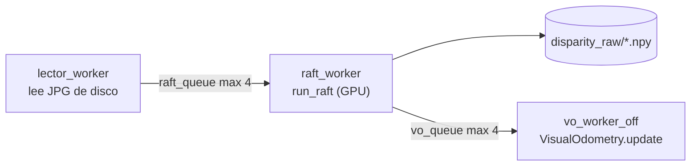

# RAFT 2: RAFT-Stereo en el proyecto

> [!info] Nivel 2 · Serie RAFT: [[RAFT 1 Intuicion]] · **2** · [[RAFT 3 Codificadores]] · [[RAFT 4 Correlacion y piramide]] · [[RAFT 5 Actualizacion con GRU]] · [[RAFT 6 Subida convexa]]

El código de la red está en la carpeta `RAFT-Stereo/` (el repositorio original de los autores). El proyecto solo lo usa desde `client_2.py`.

## Dónde se usa



Fase 2 de `client_2.py` (`slam_offline`). Mientras la GPU calcula la disparidad del frame $n+1$, la CPU ya está ubicando el frame $n$. `reprocesar.py` no usa RAFT: reutiliza las `.npy`.

## Configuración (`build_model_args`)

| Argumento | Valor | Qué significa | Nota |
|---|---|---|---|
| `corr_implementation` | `'alt'` | Calcula la correlación al vuelo en lugar de guardarla completa | [[RAFT 4 Correlacion y piramide]] |
| `corr_levels` | 4 | Pisos de la pirámide de correlación | [[RAFT 4 Correlacion y piramide]] |
| `corr_radius` | 4 | Posiciones que mira a cada lado de la estimación, por piso | [[RAFT 4 Correlacion y piramide]] |
| `n_downsample` | 2 | La red trabaja a $1/2^2 = 1/4$ de la resolución | [[RAFT 3 Codificadores]] |
| `n_gru_layers` | 3 | GRUs a 1/4, 1/8 y 1/16 | [[RAFT 5 Actualizacion con GRU]] |
| `hidden_dims` | `[128, 128, 128]` | Tamaño del estado de cada GRU | [[RAFT 5 Actualizacion con GRU]] |
| `context_norm` | `'batch'` | Normalización del codificador de contexto | [[RAFT 3 Codificadores]] |
| `mixed_precision` | `True` | Usa `float16` donde se puede: más rápido y con menos memoria | |
| `valid_iters` | `INFER_ITERS = 20` | Iteraciones de refinamiento | [[RAFT 5 Actualizacion con GRU]] |
| `shared_backbone`, `slow_fast_gru` | `False` | Opciones del modelo *realtime* | |
| `dropout` | 0.0 | Solo sirve al entrenar | |

> [!note] De dónde salen estos valores
> Son los del demo de Middlebury del README de RAFT-Stereo (`--corr_implementation alt --mixed_precision`) y tienen que corresponder a los pesos que se cargan. Si cambias de pesos, cambia también la configuración.

## Pesos disponibles (`RAFT-Stereo/models/`)

| Archivo | Uso |
|---|---|
| `raftstereo-middlebury.pth` | **El que se usa** (`RAFT_MODEL`). Ajustado con Middlebury: interiores en alta resolución |
| `raftstereo-eth3d.pth` | Ajustado con ETH3D |
| `raftstereo-sceneflow.pth` | Entrenado solo con datos sintéticos (SceneFlow) |
| `raftstereo-realtime.pth` | Versión rápida. Pide otra configuración: `--shared_backbone --n_downsample 3 --n_gru_layers 2 --slow_fast_gru --valid_iters 7` |
| `iraftstereo_rvc.pth` | Versión del *Robust Vision Challenge*; usa `--context_norm instance` |

Las rutas se pueden cambiar sin tocar el código con las variables de entorno `RAFT_DIR` y `RAFT_MODEL`.

## Carga (`load_raft_model`)

```python
model = RAFTStereo(args)
state = torch.load(str(RAFT_MODEL), map_location='cpu')
clean_state = {k.replace('module.', ''): v for k, v in state.items()}
model.load_state_dict(clean_state)
model = model.cuda().eval()
```

- Los pesos se guardaron con `nn.DataParallel`, que le antepone `module.` a cada nombre. Por eso se quita antes de cargarlos.
- `.cuda()` sube el modelo a la GPU y `.eval()` lo pone en modo inferencia (la normalización usa las estadísticas guardadas, ver [[RAFT 3 Codificadores]]).

## Una inferencia (`run_raft`)

1. **`pad32`:** rellena abajo y a la derecha (con `BORDER_REFLECT`) hasta un múltiplo de 32. El alto pasa de 720 a 736; el ancho 1280 ya es múltiplo. La red divide la imagen entre 4, 8 y 16, y la pirámide de correlación todavía más: con múltiplos de 32 todas las divisiones son exactas.
2. **`to_tensor`:** BGR → RGB (la red se entrenó con RGB) y `(H, W, 3)` → `(1, 3, H, W)` en la GPU.
3. **`model(..., iters=20, test_mode=True)`** devuelve el flujo a 1/4 y el flujo a resolución completa. Solo se usa el segundo.
4. **Signo:** la red entrega el desplazamiento horizontal $x_{der} - x_{izq}$, que es negativo. La disparidad es $d = -\text{flujo}$.
5. **`clamp(min=0)`:** una disparidad negativa es imposible (el punto quedaría detrás de la cámara). Se vuelve 0 y luego la descartan los filtros (`disp > 2`).
6. **Recorte:** `[:orig_h, :orig_w]` quita el relleno.

El decorador `@torch.no_grad()` evita que PyTorch guarde información para entrenar, lo que ahorra memoria.

> [!example] Tamaños de los datos con una imagen del proyecto
> | Etapa | Tamaño |
> |---|---|
> | Entrada | 720 × 1280 |
> | Con relleno | 736 × 1280 |
> | Características (1/4) | 184 × 320, 256 canales |
> | Estados de las GRU | 184 × 320, 92 × 160 y 46 × 80 |
> | Salida | 736 × 1280 → recorte a 720 × 1280, `float32` |
> | En disco | 1280 × 720 × 4 bytes ≈ 3.7 MB por `.npy` |

El tiempo total se imprime al final de la fase 2 como `[TIEMPO] RAFT ... ms por frame`.

## Limitaciones y riesgos

1. **Franja izquierda sin gemelo.** Un punto en la columna $u$ de la imagen izquierda aparece en $u - d$ de la derecha. Si $u < d$, el gemelo cae fuera de la imagen y RAFT da un valor inventado. Con una pared a 1 m ($d \approx 55$ px), las primeras ~55 columnas no son confiables, y el código no las descarta. Propuesta simple: en `build_point_cloud`, quitar los píxeles con $u < d$.
2. **Sin chequeo izquierda-derecha.** No se calcula la disparidad en sentido contrario para comparar; las zonas que un lente ve y el otro no (oclusiones) quedan con valores dudosos.
3. **Reflejos y superficies sin textura.** En un espejo, la disparidad que se mide es la del reflejo, no la de la superficie; el piso de madera brillante también refleja. La red rellena con contexto, y el resultado puede ser razonable o no.
4. **Iteraciones.** Menos de 20 es más rápido pero menos preciso ([[RAFT 5 Actualizacion con GRU]]). Cualquier cambio se puede medir con `[TIEMPO] RAFT` y comparando la nube.
5. **Requiere GPU NVIDIA** (`.cuda()`). Sin GPU la fase 2 no corre; `reprocesar.py` sí.
