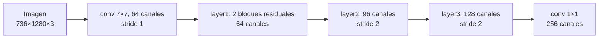

# RAFT 3: Los codificadores (de píxeles a vectores)

> [!info] Nivel 3 · Serie RAFT: [[RAFT 1 Intuicion]] · [[RAFT 2 En el proyecto]] · **3** · [[RAFT 4 Correlacion y piramide]] · [[RAFT 5 Actualizacion con GRU]] · [[RAFT 6 Subida convexa]]

Antes de comparar, cada imagen se convierte en un mapa de **vectores**: un vector por cada bloque de 4×4 píxeles. Hay dos codificadores con trabajos distintos:

| | **`fnet`** (características) | **`cnet`** (contexto) |
|---|---|---|
| Clase | `BasicEncoder` | `MultiBasicEncoder` |
| Qué imágenes procesa | Las dos | Solo la izquierda |
| Salida | 256 números por bloque, a 1/4 | Estado inicial y contexto de cada GRU, a 1/4, 1/8 y 1/16 |
| Para qué | Comparar izquierda contra derecha ([[RAFT 4 Correlacion y piramide]]) | Darle a las GRU información de "qué hay alrededor" ([[RAFT 5 Actualizacion con GRU]]) |
| Normalización | `instance` | `batch` (`context_norm`) |

## Paso 0: escalar la entrada

```python
image1 = (2 * (image1 / 255.0) - 1.0)
```

Cada valor de 0 a 255 pasa a $[-1, 1]$: 0 → −1, 127.5 → 0, 255 → 1. Las redes entrenan mejor con valores centrados en cero.

## La estructura de `fnet` con `n_downsample = 2`



| Etapa | Tamaño de salida |
|---|---|
| Entrada | 736 × 1280 × 3 |
| `conv1` + `layer1` | 736 × 1280 × 64 |
| `layer2` (stride 2) | 368 × 640 × 96 |
| `layer3` (stride 2) | 184 × 320 × 128 |
| `conv2` (1×1) | **184 × 320 × 256** |

Un *stride* de 2 significa que la convolución avanza de 2 en 2 píxeles: la salida tiene la mitad de ancho y de alto. Dos *strides* de 2 dan el factor 1/4. (Con `n_downsample = 3`, el valor por defecto del repositorio, `conv1` también tendría stride 2 y la red trabajaría a 1/8.)

Las dos imágenes se juntan en un solo lote, pasan juntas por la red y se vuelven a separar: así comparten exactamente los mismos pesos.

### El bloque residual

Cada `layer` son dos bloques residuales. Un bloque calcula dos convoluciones de 3×3 (cada una con normalización y ReLU) y **le suma la entrada**:

$$
\mathbf{y} = \operatorname{ReLU}\big(\mathbf{x} + F(\mathbf{x})\big)
$$

La red solo tiene que aprender la **corrección** $F(\mathbf{x})$, no la salida completa. Eso permite apilar muchas capas sin que el entrenamiento se atore. Cuando el bloque cambia el tamaño o los canales, la entrada pasa por una convolución de 1×1 para que la suma cuadre.

## `cnet`: contexto a tres escalas

Usa el mismo tronco que `fnet` (hasta 1/4, 128 canales) y agrega dos etapas más con stride 2:

| Salida | Escala | Tamaño | Alimenta a |
|---|---|---|---|
| `outputs08` (`layer3`) | 1/4 | 184 × 320 | GRU fina |
| `outputs16` (`layer4`) | 1/8 | 92 × 160 | GRU media |
| `outputs32` (`layer5`) | 1/16 | 46 × 80 | GRU gruesa |

Los nombres `08/16/32` vienen de la configuración por defecto (1/8, 1/16, 1/32); con `n_downsample = 2` cada uno es la mitad.

De cada escala salen dos mapas de 128 canales:

```python
net_list = [torch.tanh(x[0]) for x in cnet_list]   # estado inicial de cada GRU
inp_list = [torch.relu(x[1]) for x in cnet_list]   # contexto
inp_list = [conv(i).split(...) for i, conv in zip(inp_list, self.context_zqr_convs)]
```

- `tanh` deja el estado entre −1 y 1, el mismo rango que usa la GRU.
- El contexto pasa una sola vez por `context_zqr_convs`, que lo parte en tres términos ($c_z$, $c_r$, $c_q$) que se suman dentro de la GRU en **cada** iteración. Calcularlos una vez al principio ahorra 20 convoluciones por escala.

## ¿Por qué *instance norm* en las características?

La normalización por instancia toma **cada canal de cada imagen por separado** y lo lleva a promedio 0 y desviación 1:

$$
\hat{x} = \frac{x - \mu_{canal,\ imagen}}{\sigma_{canal,\ imagen}}
$$

> [!example] Ejemplo: un lente ve todo más claro
> En un canal de la imagen izquierda, el promedio es 50 y la desviación 10. Un píxel vale 70 → normalizado: $(70 - 50)/10 = 2.0$.
> El lente derecho capta todo 20 niveles más claro: promedio 70, el mismo píxel vale 90 → $(90 - 70)/10 = 2.0$.
> Después de normalizar, el mismo punto da el mismo valor en las dos imágenes. Eso es justo lo que se necesita para compararlas.

El contexto usa *batch norm*: en modo `.eval()` usa promedios y desviaciones fijos que se aprendieron al entrenar, en lugar de calcularlos para cada imagen. Ahí no hace falta la robustez a cambios de brillo, porque el contexto viene de una sola imagen.
