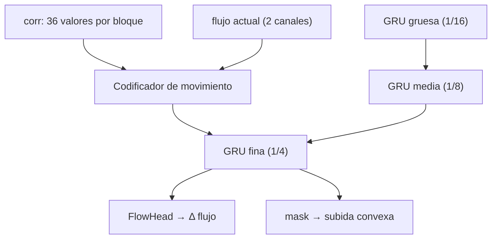

# RAFT 5: Actualización iterativa con GRU

> [!info] Nivel 3 · Serie RAFT: [[RAFT 1 Intuicion]] · [[RAFT 2 En el proyecto]] · [[RAFT 3 Codificadores]] · [[RAFT 4 Correlacion y piramide]] · **5** · [[RAFT 6 Subida convexa]]

## La idea

La disparidad empieza en 0 para todos los bloques y se corrige 20 veces:

$$
d_{t+1} = d_t + \Delta d_t, \qquad t = 0, 1, \dots, 19
$$

En el código no se guarda $d$ directamente sino la posición del gemelo: `coords1 = coords0 + flujo`, y el flujo es $-d$.

```python
for itr in range(iters):
    corr = corr_fn(coords1)            # 36 valores alrededor de la estimacion
    flow = coords1 - coords0           # estimacion actual
    net_list, up_mask, delta_flow = self.update_block(net_list, inp_list, corr, flow, ...)
    delta_flow[:, 1] = 0.0             # estereo: sin movimiento vertical
    coords1 = coords1 + delta_flow
```

`delta_flow[:, 1] = 0.0` borra la componente vertical de la corrección: con las imágenes rectificadas, el gemelo siempre está en la misma fila.

## Una iteración por dentro



### 1. Codificador de movimiento (`BasicMotionEncoder`)

| Entrada | Capas | Salida |
|---|---|---|
| Correlación (36 canales) | conv 1×1 → 64, conv 3×3 → 64 | 64 canales |
| Flujo actual (2 canales) | conv 7×7 → 64, conv 3×3 → 64 | 64 canales |
| Las dos juntas (128) | conv 3×3 → 126, y se le pega el flujo (2) | **128 canales** |

Resume en un vector "qué tan bien coincide la estimación actual y hacia dónde mejoraría".

### 2. Las tres GRU, de la gruesa a la fina

Cada iteración actualiza primero la GRU de 1/16, luego la de 1/8 y al final la de 1/4. Cada una recibe información de sus vecinas:

| GRU | Escala | Recibe |
|---|---|---|
| Gruesa | 1/16 (46 × 80) | Su contexto + el estado de la media, reducido a la mitad (`pool2x`) |
| Media | 1/8 (92 × 160) | Su contexto + la fina reducida (`pool2x`) + la gruesa ampliada (`interp`) |
| Fina | 1/4 (184 × 320) | Su contexto + el codificador de movimiento + la media ampliada (`interp`) |

La gruesa "ve" mucho alrededor (útil en paredes lisas, donde la respuesta depende del contexto lejano) y la fina cuida el detalle. Solo la fina recibe la correlación.

### 3. La GRU (`ConvGRU`)

Una GRU tiene un **estado** $h$ (su memoria) y en cada paso decide cuánto de él cambiar. Con $x$ = lo que entra y $[\cdot,\cdot]$ = pegar canales:

$$
\begin{aligned}
z &= \sigma\big(\operatorname{conv}_z([h, x]) + c_z\big) && \text{cuánto actualizar (0 a 1)} \\
r &= \sigma\big(\operatorname{conv}_r([h, x]) + c_r\big) && \text{cuánto de la memoria usar para la propuesta} \\
q &= \tanh\big(\operatorname{conv}_q([r \odot h, x]) + c_q\big) && \text{la propuesta nueva} \\
h &\leftarrow (1 - z) \odot h + z \odot q
\end{aligned}
$$

- $\sigma$ es la sigmoide (deja los valores entre 0 y 1) y $\odot$ multiplica elemento por elemento.
- $c_z, c_r, c_q$ son los términos de contexto calculados una sola vez ([[RAFT 3 Codificadores]]).
- Las convoluciones son de 3×3: cada bloque mira a sus vecinos, así que la información se propaga por la imagen iteración tras iteración.

> [!example] Ejemplo con un solo número
> Estado $h = 0.6$, propuesta $q = -0.2$.
> - Si $z = 0.1$: $h \leftarrow 0.9 \cdot 0.6 + 0.1 \cdot (-0.2) = 0.52$. Casi no cambia: la GRU "confía" en lo que ya sabía.
> - Si $z = 0.9$: $h \leftarrow 0.1 \cdot 0.6 + 0.9 \cdot (-0.2) = -0.12$. Casi la reemplaza por la propuesta.

### 4. De estado a corrección (`FlowHead`)

Dos convoluciones de 3×3 (128 → 256 → 2) convierten el estado de la GRU fina en $\Delta$ flujo $(\Delta x, \Delta y)$. La $\Delta y$ se borra, y la $\Delta x$ se suma a la estimación.

## ¿Cuántas iteraciones?

Cada iteración cuesta lo mismo, así que el tiempo crece en línea recta con `INFER_ITERS`. Las primeras iteraciones hacen los cambios grandes y las últimas solo afinan.

> [!example] Ilustración (valores inventados para mostrar la forma, no medidos)
> Un bloque cuya disparidad real es 26 px podría avanzar así: 0 → 12 → 21 → 24.8 → 25.7 → 25.95 → 26.0 …
> Cortar en 7 iteraciones daría casi el mismo resultado en ese bloque; donde más se nota la diferencia es en zonas difíciles (paredes lisas, bordes), que tardan más en asentarse.

El modelo *realtime* usa solo 7 iteraciones con otra arquitectura ([[RAFT 2 En el proyecto]]). Para decidir un valor para el proyecto hay que medir: tiempo con `[TIEMPO] RAFT` y calidad comparando la nube y la cobertura de la odometría.
