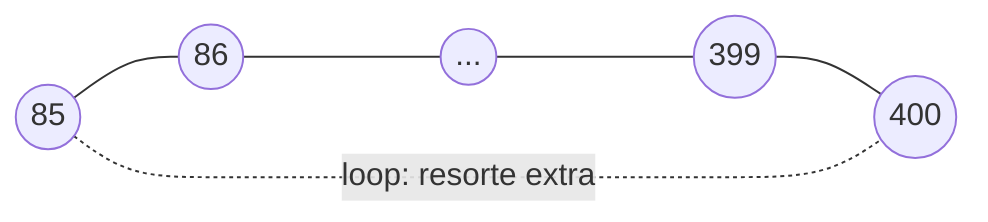

# LC 1: Intuición

> [!info] Nivel 1 · Serie LC: **1** · [[LC 2 En el proyecto]] · [[LC 3 Deteccion de candidatos]] · [[LC 4 Verificacion geometrica]] · [[LC 5 Grafo de poses]] · [[LC 6 Optimizacion]]

> [!warning] Estado al 18-oct-2026: apagado
> `USE_LOOP_CLOSURE = False`. Los motivos están en [[LC 2 En el proyecto]].

## El problema: el *drift*

La odometría suma pasos, y cada paso trae un error pequeño ([[VO 6 Pose acumulada y fallos]]). Después de dar una vuelta completa al cuarto, el carro debería terminar donde empezó, pero el camino calculado no cierra: queda unos centímetros (o más) desviado.

## La idea: reconocer dónde ya estuviste

Si en el frame 400 el carro ve la misma esquina del cuarto que vio en el frame 85, se obtiene un dato que la odometría no tenía: **"estoy a tal distancia y con tal giro respecto a donde estaba en el frame 85"**. Con ese dato se puede corregir **todo** el camino entre 85 y 400, no solo el último paso.

Se hace en tres pasos:

| Paso | Pregunta | Nota |
|---|---|---|
| 1. Detectar candidatos | ¿Este lugar se parece a alguno que ya vi? | [[LC 3 Deteccion de candidatos]] |
| 2. Verificar | ¿De verdad es el mismo lugar? ¿Dónde estoy respecto a él? | [[LC 4 Verificacion geometrica]] |
| 3. Optimizar | ¿Cómo reparto la corrección entre todos los pasos? | [[LC 5 Grafo de poses]], [[LC 6 Optimizacion]] |

## Una analogía: nudos y resortes

Imagina cada pose como un nudo y cada medición como un resorte entre dos nudos:

- Cada paso de la odometría es un resorte entre dos frames seguidos.
- Cada loop es un resorte entre dos frames lejanos en el tiempo.

Cada resorte "quiere" tener la longitud que se midió. Cuando un loop contradice a la odometría, no hay forma de que todos queden contentos. El **PGO** (*Pose Graph Optimization*) acomoda los nudos para que los resortes queden **lo menos estirados posible**. Un resorte más rígido (con más peso) se respeta más.

## El peligro: un loop falso

Un loop que no se detecta cuesta poco: el mapa se queda con su drift. Un loop **falso** (confundir dos lugares parecidos) es mucho peor: le dice al optimizador "estos dos lugares son el mismo", y el optimizador dobla todo el mapa para cumplirlo.

Eso pasó en el proyecto: con loops falsos, el recorrido calculado pasó de **4 m a 90 m**. Por eso un sistema de loop closure tiene que ser **muy desconfiado**: es mejor perder diez loops buenos que aceptar uno malo.
