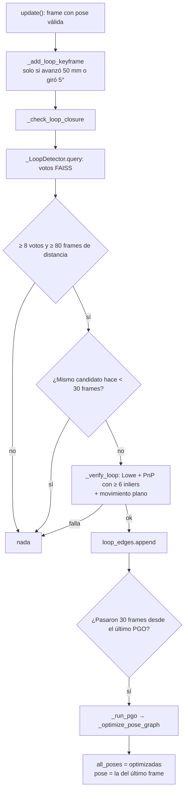

# LC 2: El loop closure en el proyecto

> [!info] Nivel 2 · Serie LC: [[LC 1 Intuicion]] · **2** · [[LC 3 Deteccion de candidatos]] · [[LC 4 Verificacion geometrica]] · [[LC 5 Grafo de poses]] · [[LC 6 Optimizacion]]

## Estado

`USE_LOOP_CLOSURE = False` en `visual_odometry.py`. Para experimentar sin tocar el código:

```bash
python reprocesar.py --loops --sparse
```

En la consola aparecen `[LC] Loop closure: frame A <-> B (N votos)` y `[PGO] Optimizando ...`. Para saber si el resultado mejoró, compara el **recorrido** y el **desplazamiento neto** que imprime `reprocesar.py` contra una corrida sin `--loops`.

## El flujo



| Pieza | Dónde | Nota |
|---|---|---|
| `_add_loop_keyframe` | `VisualOdometry` | [[LC 3 Deteccion de candidatos]] |
| `_LoopDetector` (`add`, `query`) | Clase aparte, índice FAISS | [[LC 3 Deteccion de candidatos]] |
| `_check_loop_closure` | `VisualOdometry` | Este diagrama |
| `_verify_loop` | `VisualOdometry` | [[LC 4 Verificacion geometrica]] |
| `seq_edges`, `loop_edges`, `all_poses` | `VisualOdometry` | [[LC 5 Grafo de poses]] |
| `_optimize_pose_graph`, `_run_pgo` | Función del módulo / `VisualOdometry` | [[LC 6 Optimizacion]] |

## Constantes

| Constante | Valor | Qué controla |
|---|---|---|
| `USE_LOOP_CLOSURE` | `False` | Prende todo el mecanismo |
| `LC_KF_MOV_MM` / `LC_KF_ROT_DEG` | 50 mm / 5° | Cuándo un frame entra al índice |
| `LC_HAMMING_MAX` | 80 | Distancia máxima para que una huella vote |
| `MIN_LOOP_SEP` | 80 frames | Separación mínima en el tiempo |
| `MIN_LOOP_VOTES` | 8 | Votos mínimos para un candidato |
| `MIN_LOOP_INLIERS` | 6 | Inliers de PnP para aceptar el loop |
| `LOOP_CHECK_EVERY` | 1 | Buscar en cada frame |
| `LOOP_PGO_COOLDOWN` | 30 frames | No repetir PGO ni el mismo loop muy seguido |
| `PGO_WEIGHT_LOOP` | 5.0 | Cuánto más pesa un loop que un paso de odometría |
| `PGO_ROT_SIGMA_DEG` / `PGO_TRANS_SIGMA` | 1° / 10 mm | Error "normal" por arista |
| `PGO_MAX_ITER` | 50 | Evaluaciones máximas de `least_squares` |

## Historia y hallazgos (18-oct-2026)

### 1. Estaba muerto

FAISS busca solo el vecino más cercano (`k=1`). Con todos los frames en el índice, ese vecino casi siempre era un frame reciente y se descartaba. En `session_20261018_114813`: 476 mil huellas en el índice y **0 loops**. Ver [[LC 3 Deteccion de candidatos]].

### 2. Al revivirlo dio loops falsos

Con solo keyframes en el índice aparecieron 20 loops, varios falsos. Por ejemplo, 85→180 con un giro de **142°**: con un campo de visión de unos 70°, dos vistas giradas así no pueden compartir escena. Con 6 inliers PnP no basta para verificar ([[LC 4 Verificacion geometrica]]), y el PGO sin pérdida robusta se desarmó: el recorrido pasó de **4 m a 90 m** ([[LC 6 Optimizacion]]).

### 3. El grafo queda partido después de 5 fallos seguidos

Ver [[LC 5 Grafo de poses]].

### 4. Qué falta para volver a prenderlo

1. **Más inliers** en `_verify_loop` (por ejemplo 30 en lugar de 6).
2. **Consistencia con la odometría:** rechazar el loop si su giro difiere mucho del que predice la odometría ([[LC 4 Verificacion geometrica]]). Esto habría tumbado el loop 85→180.
3. **Exigir que el loop se repita** en varios frames seguidos antes de aceptarlo.
4. **`loss='huber'`** en `least_squares` ([[LC 6 Optimizacion]]).
5. **Arista débil** al reiniciar por `MAX_FALLOS` ([[LC 5 Grafo de poses]]).
6. **Medir:** recorrido y error final contra una corrida sin loops, igual que en la prueba de frames negros de [[VO 6 Pose acumulada y fallos]].
