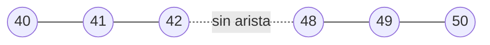

# LC 5: El grafo de poses y sus residuos

> [!info] Nivel 2 → 3 · Serie LC: [[LC 1 Intuicion]] · [[LC 2 En el proyecto]] · [[LC 3 Deteccion de candidatos]] · [[LC 4 Verificacion geometrica]] · **5** · [[LC 6 Optimizacion]] · Requisito: [[Pose y matrices 4x4]]

## Nivel 2: las piezas

| Elemento | En el código | Qué es | Peso |
|---|---|---|---|
| Nodos | `all_poses` = `{frame: 4x4}` | Pose cámara → mundo de cada frame con pose válida | |
| Aristas secuenciales | `seq_edges` = `[(i, j, T_ij)]` | Lo que midió la odometría entre la referencia y el frame actual | 1 |
| Aristas de loop | `loop_edges` = `[(a, b, T_ab)]` | Lo que midió `_verify_loop` entre dos frames lejanos en el tiempo | `PGO_WEIGHT_LOOP = 5` |

Las aristas secuenciales se crean en `update()` cada vez que un frame sale bien:

```python
T_rel = np.linalg.inv(self.all_poses[self._prev_idx]) @ self.pose
self.seq_edges.append((self._prev_idx, frame_idx, T_rel))
```

### La convención

$$
T_{ij} = P_i^{-1}\, P_j
$$

"Dónde está la cámara $j$ vista desde la cámara $i$". Si $P_i$ y $P_j$ son poses cámara → mundo, $P_i^{-1}$ lleva del mundo a la cámara $i$, así que $P_i^{-1} P_j$ lleva de la cámara $j$ a la cámara $i$.

> [!example] Ejemplo
> El frame 10 está en el origen ($P_{10} = I$) y el 11 avanzó 100 mm ($P_{11}$ con traslación $(0, 0, 100)$). Entonces $T_{10,11} = I^{-1} P_{11}$: traslación $(0, 0, 100)$. Visto desde el frame 10, el 11 está 100 mm adelante.

## Nivel 3: el residuo

Para cada arista $(i, j)$ con medición $T_{ij}$ y poses estimadas $P_i, P_j$:

$$
E_{ij} = T_{ij}^{-1}\; P_i^{-1}\, P_j
$$

Si la estimación coincide con la medición, $E_{ij} = I$. Los **6 residuos** de la arista son el giro (vector de Rodrigues) y la traslación de $E_{ij}$, divididos entre su sigma y multiplicados por la raíz del peso:

$$
\mathbf{r}_{ij} = \sqrt{w}\begin{bmatrix} \operatorname{rvec}(E_{ij}) \,/\, \sigma_{rot} \\ \mathbf{t}(E_{ij}) \,/\, \sigma_t \end{bmatrix},
\qquad
\text{costo} = \sum_{(i,j)} \lVert \mathbf{r}_{ij} \rVert^2
$$

```python
T_err = T_meas_inv @ np.linalg.inv(pose_of(x, i)) @ pose_of(x, j)
rvec, _ = cv2.Rodrigues(T_err[:3, :3])
r[6*e   : 6*e+3] = sw * rvec.ravel() / rot_sigma        # rot_sigma = 1 grado en radianes
r[6*e+3 : 6*e+6] = sw * T_err[:3, 3] / PGO_TRANS_SIGMA  # 10 mm
```

### ¿Por qué dividir entre las sigmas?

Sin dividir, 1 mm de error pesaría lo mismo que 1 radián (57°), y las traslaciones dominarían. Al dividir, los residuos quedan **sin unidades**: con $\sigma_{rot} = 1°$ y $\sigma_t = 10$ mm, **1° de error de giro cuesta lo mismo que 10 mm de traslación**.

### ¿Por qué $\sqrt{w}$?

Porque el residuo se eleva al cuadrado: $(\sqrt{w}\, r)^2 = w\, r^2$. Un loop con peso 5 cuenta como 5 aristas de odometría con el mismo error.

> [!example] Ejemplo en una dimensión
> El carro avanza tres tramos. La odometría mide 100 mm en cada uno, así que $x_3 = 300$. Un loop dice que en realidad $x_3 - x_0 = 270$. Con $x_0 = 0$ fijo, por simetría los tres tramos quedan iguales ($d$), y el costo es
>
> $$f(d) = 3\,(d - 100)^2 + w\,(3d - 270)^2$$
>
> Derivando e igualando a cero: $6(d - 100) + 6w(3d - 270) = 0$, así que $d = \dfrac{600 + 1620\,w}{6 + 18\,w}$.
>
> | Caso | Cada tramo | $x_3$ |
> |---|---|---|
> | Solo odometría | 100 mm | 300 mm |
> | Loop con peso 1 | 92.5 mm | 277.5 mm |
> | Loop con peso 5 (el del código) | 90.6 mm | 271.9 mm |
>
> El error de 30 mm **se reparte entre los tres tramos** en lugar de cargarse todo al último, y el peso decide a quién se le cree más.

> [!note] Sin loops, el PGO no cambia nada
> Las aristas secuenciales salen de las mismas poses que se están optimizando, así que al inicio todas tienen residuo 0. El PGO solo mueve poses cuando un loop contradice a la odometría.

## Hallazgo: el grafo queda partido después de 5 fallos seguidos

Cuando `_fallo()` reinicia la referencia (`MAX_FALLOS = 5`, ver [[VO 6 Pose acumulada y fallos]]):

- el frame del reinicio conserva la última pose conocida en `all_poses`;
- se vuelve la referencia (`_prev_idx`), así que el siguiente frame bueno sí se une a él;
- pero **ninguna arista lo une con el último frame bueno**.



(Ejemplo: 42 es el último bueno, 43 a 47 fallan y en 48 se reinicia.)

- **Sin loops** no pasa nada: el PGO no mueve poses.
- **Con loops**, el pedazo de después del reinicio no está anclado a la primera pose. Un loop entre los dos pedazos lo puede mover como quiera.

Propuesta: al reiniciar, agregar una arista **débil** del último frame bueno al frame del reinicio con la identidad ("no sé cuánto me moví; probablemente poco"). Para que sea débil necesita un peso propio y bajo, por ejemplo con una tercera lista de aristas.
