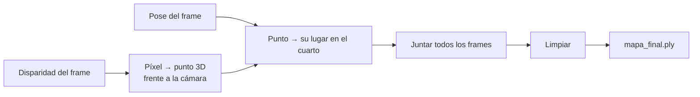

# Nube 1: Intuición

> [!info] Nivel 1 · Serie Nube: **1** · [[Nube 2 En el proyecto]] · [[Nube 3 Reproyeccion y keyframes]] · [[Nube 4 Filtros de ruido]] · [[Nube 5 Voxel y DBSCAN]] · [[Nube 6 Piso y alineacion]] · [[Nube 7 Nube sparse]]

## ¿Qué es?

Una **nube de puntos** es una lista de puntos 3D, cada uno con su color. Vista de lejos, forma las paredes, el piso y los muebles del cuarto. Es el mapa que produce el proyecto (`mapa_final.ply`).

## ¿Cómo se arma?

Cada frame aporta dos cosas:

1. La **disparidad** de cada píxel (RAFT), que dice a qué distancia está lo que se ve en ese píxel.
2. La **pose** del frame (la odometría), que dice dónde estaba la cámara y hacia dónde miraba.

Con la distancia, cada píxel se vuelve un punto 3D **frente a la cámara**. Con la pose, ese punto se coloca **en el cuarto**. Si se hace con cientos de frames, el cuarto aparece.

## ¿Por qué hay que limpiar?

Juntar frames así trae cuatro problemas:

| Problema | De dónde sale | Solución | Nota |
|---|---|---|---|
| **Puntos dudosos** | Píxeles muy lejanos, sin textura o en un borde | Quitar los que no cumplen un rango de distancia y los que flotan lejos de sus vecinos | [[Nube 3 Reproyeccion y keyframes]], [[Nube 4 Filtros de ruido]] |
| **Puntos repetidos** | Muchos frames ven la misma pared | Dividir el espacio en cubitos y dejar un punto por cubito | [[Nube 5 Voxel y DBSCAN]] |
| **Basura suelta** | Reflejos, errores de pose | Quedarse solo con el bloque principal | [[Nube 5 Voxel y DBSCAN]] |
| **Mapa chueco** | El mundo es el sistema de la primera cámara, que puede estar inclinada | Encontrar el piso y enderezarlo | [[Nube 6 Piso y alineacion]] |

## Dos nubes

| | **Densa** | **Sparse** |
|---|---|---|
| Qué puntos usa | Todos los píxeles con buena distancia (cientos de miles por frame) | Solo las esquinas ORB (unas 1000 por frame) |
| Velocidad | Lenta | Rápida |
| Para qué | El mapa detallado | Ver rápido la forma del cuarto y el camino del carro |
| Nota | [[Nube 2 En el proyecto]] | [[Nube 7 Nube sparse]] |

## Una analogía

Es como tomar fotos de un cuarto con una cámara que, además del color, mide la distancia de cada píxel. Cada foto es un "pedazo" del cuarto en 3D. Si sabes desde dónde tomaste cada foto, puedes encimar los pedazos como un rompecabezas. Pero si te equivocas un poco al decir desde dónde la tomaste, las piezas no embonan: aparecen paredes dobles. Por eso la calidad del mapa depende tanto de la odometría ([[VO 1 Intuicion]]).
