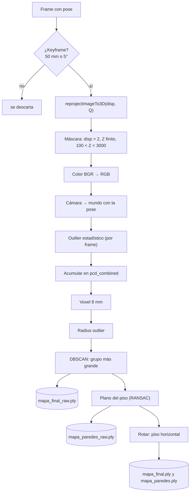

# Nube 2: La nube densa en el proyecto (`build_point_cloud`)

> [!info] Nivel 2 · Serie Nube: [[Nube 1 Intuicion]] · **2** · [[Nube 3 Reproyeccion y keyframes]] · [[Nube 4 Filtros de ruido]] · [[Nube 5 Voxel y DBSCAN]] · [[Nube 6 Piso y alineacion]] · [[Nube 7 Nube sparse]]

## Quién la llama

| Dónde | Cuándo |
|---|---|
| `client_2.py` → `main` | Fase 3, después del SLAM offline |
| `reprocesar.py` | Sin `--sparse`, después de la odometría |

Recibe la sesión (`sess['sd']`), el objeto `vo` (de ahí saca las poses con `vo.get_all_poses()`) y la matriz `Q`. Usa Open3D; si no está instalado, avisa y no hace nada.

## El pipeline

| # | Paso | Nota |
|---|---|---|
| 1 | Keyframe: avanzó ≥ 50 mm o giró ≥ 5° | [[Nube 3 Reproyeccion y keyframes]] |
| 2 | Píxeles → 3D con Q | [[Nube 3 Reproyeccion y keyframes]] |
| 3 | Máscara de 4 filtros | [[Nube 3 Reproyeccion y keyframes]] |
| 4 | Color | [[Nube 3 Reproyeccion y keyframes]] |
| 5 | Cámara → mundo | [[Nube 3 Reproyeccion y keyframes]] |
| 6 | Outlier estadístico, por frame | [[Nube 4 Filtros de ruido]] |
| 7 | Acumular | |
| 8 | Voxel downsample, una vez | [[Nube 5 Voxel y DBSCAN]] |
| 9 | Radius outlier | [[Nube 4 Filtros de ruido]] |
| 10 | DBSCAN | [[Nube 5 Voxel y DBSCAN]] |
| 11 | Guardar la versión `_raw` | |
| 12 | Plano del piso y rotación | [[Nube 6 Piso y alineacion]] |
| 13 | Paredes = todo menos el piso | [[Nube 6 Piso y alineacion]] |

## Parámetros (constantes dentro de la función)

| Constante | Valor | Para qué |
|---|---|---|
| `DISP_MIN` | 2.0 px | Disparidad mínima confiable |
| `Z_MIN` / `Z_MAX` | 100 / 3000 mm | Rango de profundidad útil |
| `MIN_POSE_MOV` / `MIN_POSE_ROT` | 50 mm / 5° | Criterio de keyframe |
| `STAT_K` / `STAT_STD` | 20 / 2.0 | Outlier estadístico |
| `VOXEL_SIZE` | 8 mm | Tamaño del cubito de fusión |
| `RAD_POINTS` / `RAD_RADIUS` | 8 / 40 mm | Radius outlier |
| DBSCAN | `eps = 60 mm`, `min_points = 20` | Agrupamiento |
| `DBSCAN_MAX` | 2,000,000 | Arriba de esto se salta DBSCAN |
| Plano del piso | 30 mm, 3 puntos, 1000 iteraciones | `segment_plane` |

## Archivos de salida (en la carpeta de la sesión)

| Archivo | Contenido |
|---|---|
| `poses.txt` | Una línea por frame: X, Y, Z en mm y rotación (Rodrigues en grados) |
| `mapa_final_raw.ply` | Nube filtrada, en el sistema de la cámara del frame 0 |
| `mapa_paredes_raw.ply` | Lo mismo sin el piso |
| `mapa_final.ply` | Nube filtrada con el piso horizontal |
| `mapa_paredes.ply` | Sin el piso, con el piso horizontal |

Para verlos: `python ver_nube.py` abre `mapa_final.ply` de la última sesión; `python ver_nube.py archivo1.ply archivo2.ply` abre varios juntos. Los ejes que dibuja miden 100 mm: rojo = X, verde = Y, azul = Z.

## Lo que imprime

| Mensaje | Qué dice |
|---|---|
| `Frame N descartada porque o no se movio...` | No fue keyframe |
| `[PC] frame N — ... píxeles totales` (cada 10 frames) | Cuántos píxeles quitó cada filtro de la máscara y el outlier estadístico |
| `[PC] Voxel downsample: A → B` | Cuántos puntos se fusionaron |
| `[PC] Radius outlier: A → B` | Cuántos estaban solos |
| `[PC] DBSCAN: ...` | Grupos encontrados, tamaño del principal y del ruido |
| `[PC] Suelo detectado: normal=..., inliers=...` | La normal del plano que se usó para enderezar |
| `[TIEMPO] ...` | Tiempo de cada etapa |

## Hallazgos

1. **La alineación no verifica que el plano sea el piso.** Ver [[Nube 6 Piso y alineacion]].
2. **El eje Y apunta hacia abajo** en el mapa final. Ver [[Nube 6 Piso y alineacion]].
3. **La franja izquierda sin gemelo** de RAFT (columnas $u < d$) entra a la nube sin filtro. Ver [[RAFT 2 En el proyecto]].
4. **Código muerto:** `ICP_MIN_FIT`, `skipped_icp` y `prev_pcd` ya no se usan, `FRAME_STRIDE = 1` no hace nada, quedan bloques de DBSCAN comentados y `pcd_raw_for_export` es solo una copia de `pcd_final`.
