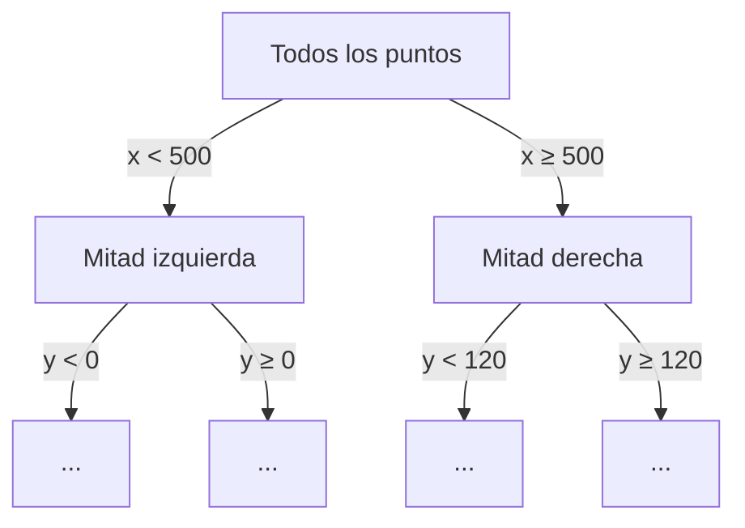

# Nube 4: Filtros de ruido (outlier estadístico y radius)

> [!info] Nivel 2 → 3 · Serie Nube: [[Nube 1 Intuicion]] · [[Nube 2 En el proyecto]] · [[Nube 3 Reproyeccion y keyframes]] · **4** · [[Nube 5 Voxel y DBSCAN]] · [[Nube 6 Piso y alineacion]] · [[Nube 7 Nube sparse]]

Los dos filtros buscan lo mismo: **puntos que flotan lejos de sus vecinos**. Casi siempre salen de bordes de profundidad (un punto a medio camino entre un objeto y el fondo) o de reflejos.

| Filtro | Dónde | Parámetros | Pregunta que hace |
|---|---|---|---|
| Outlier estadístico | Por frame, antes de acumular | 20 vecinos, 2σ | ¿Este punto está mucho más lejos de sus vecinos que lo normal **en este frame**? |
| Radius outlier | Una vez, después del voxel | 8 vecinos en 40 mm | ¿Este punto tiene suficiente compañía? |

## Outlier estadístico

```python
pcd, ind = pcd.remove_statistical_outlier(nb_neighbors=STAT_K, std_ratio=STAT_STD)   # 20, 2.0
```

1. Para cada punto $i$, calcula la distancia promedio a sus $k = 20$ vecinos más cercanos:

$$
\bar d_i = \frac{1}{k}\sum_{j=1}^{k} \lVert p_i - p_{(j)} \rVert
$$

2. Calcula el promedio $\mu$ y la desviación $\sigma$ de todos los $\bar d_i$ del frame.
3. Borra los puntos con

$$
\bar d_i > \mu + 2\sigma
$$

> [!example] Ejemplo
> En un frame, $\mu = 5$ mm y $\sigma = 2$ mm, así que el umbral es 9 mm. Un punto en la pared con $\bar d = 4$ mm se queda; un punto "flotando" entre un objeto y el fondo, con $\bar d = 15$ mm, se borra.

El umbral es **relativo** al frame: en un frame cercano (puntos más juntos) $\mu$ es chica y el filtro es estricto; en uno lejano se adapta solo. Se aplica por frame porque ahí todos los puntos tienen un ruido parecido; mezclados con otros frames, el ruido de uno taparía el del otro.

## Radius outlier

```python
pcd_tmp, _ = pcd_combined.remove_radius_outlier(nb_points=RAD_POINTS, radius=RAD_RADIUS)   # 8, 40 mm
```

Borra un punto si tiene menos de 8 vecinos a menos de 40 mm.

> [!example] ¿Cuántos vecinos tiene una pared?
> Después del voxel de 8 mm queda más o menos un punto cada 8 mm. En una superficie plana, el círculo de 40 mm de radio contiene unos
> $$\frac{\pi \cdot 40^2}{8^2} \approx 78 \text{ puntos}$$
> Pedir 8 solo quita puntos que de verdad están solos, o bordes muy delgados (un cable, la orilla de una hoja).

Se aplica **después** del voxel a propósito: antes, una zona vista por muchos frames tendría cientos de puntos repetidos y casi nada se vería "solo".

## Cómo se encuentran los vecinos: el KD-tree

Los dos filtros (y DBSCAN, [[Nube 5 Voxel y DBSCAN]]) necesitan los vecinos de cada punto. Compararlo contra todos los demás sería carísimo: con un millón de puntos, un millón de distancias **por punto**.

Open3D usa un **KD-tree**: un árbol que parte el espacio por la mitad una y otra vez, alternando el eje (primero por X, luego Y, luego Z…).



Para buscar los vecinos de un punto se baja por el árbol hasta su "cajón" y solo se revisan los cajones cercanos. Con un millón de puntos el árbol tiene unos 20 niveles ($2^{20} \approx 10^6$), así que cada búsqueda revisa unos cuantos cajones en lugar de un millón de puntos.
